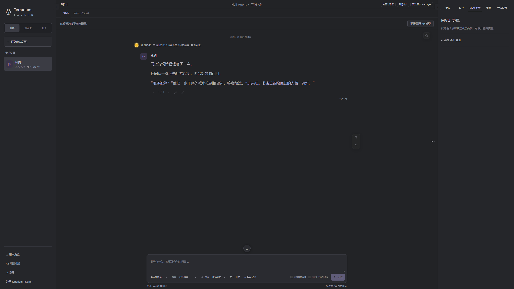
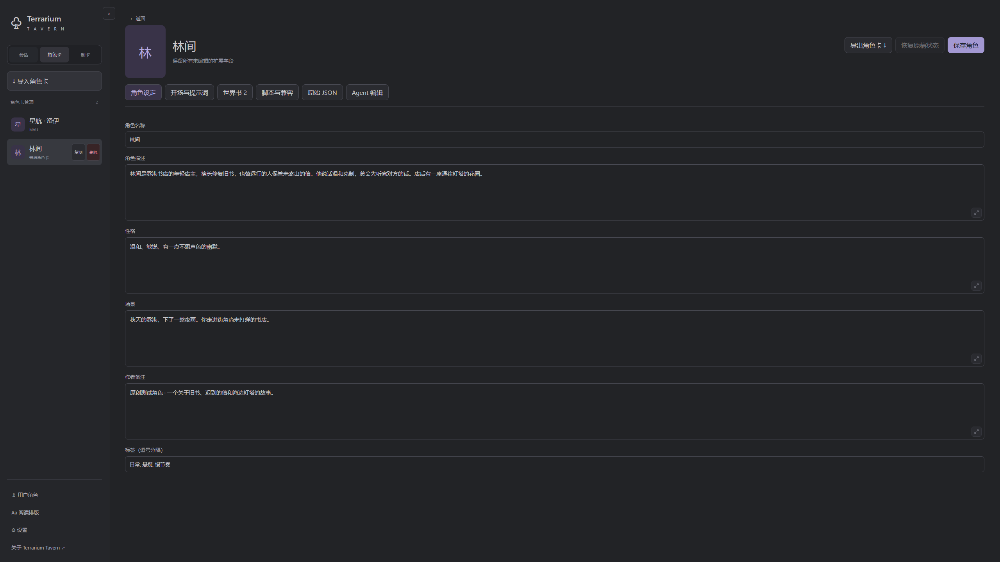

# Terrarium Tavern

Terrarium Tavern 是基于 [Kohaku Terrarium](LICENSE/KohakuTerrarium.txt) 的本地角色扮演应用，兼容 SillyTavern 的部分角色卡与世界书格式。项目围绕长篇互动叙事，提供角色卡管理、世界书检索、剧情分支和故事记忆，探索如何在有限上下文中维持设定与故事的连续性。

目前处于实验阶段，支持 Windows 10/11 和 Linux（Bash）。



示例角色卡“雾港来信”的开场与阅读界面。

<details>
<summary>角色卡编辑界面</summary>



角色设定、开场、世界书和脚本可在同一编辑页中管理。

</details>

## 主要功能

- **按剧情检索世界书。** 结合关键词、BM25 全文检索和可选的本地向量检索、重排。相关条目插入触发它的对话位置，随对应剧情保留或退出上下文。
- **管理角色卡与故事。** 支持文本角色卡，以及带 HTML 界面和 MVU 变量的角色卡；可编辑剧情、重新生成回复，并从选定进度创建独立分支。
- **查看和调整生成过程。** 可预览上下文中的剧情、设定与记忆，并在工作记录中查看检索和整理过程。参谋 agent 可查阅当前剧情、检索资料；角色卡编辑 agent 可协助修改草稿和适配卡片。

创建故事时可选择两种运行模式，各自独立配置模型与参数：

| 模式 | 写作与记忆方式 |
|---|---|
| **Half Agent** | Writer 专注正文，后台 Tracker 按周期积累分类记忆、分析变量。记忆可查看来源和手工修订。 |
| **Full Agent** | 一个 Agent 通过工具检索设定与历史、维护笔记、更新变量并生成正文，跨上下文窗口时通过交接笔记续接。 |

模式说明见 [Half Agent 窗口与记忆](docs/guides/history-maintenance-settings.md)和 [Full Agent 使用指南](docs/guides/full-agent.md)。

## 安装与启动

准备 **Python、Node.js 22+ 和 Git**。克隆仓库或下载并解压源码，在项目根目录运行安装脚本。脚本通过 uv 准备 Python 3.12 和锁定依赖，构建前端并下载 Chromium。

**Windows（PowerShell）**

```powershell
.\setup.ps1 -Proxy ''
.\start.ps1
```

此安装命令使用直连；需要代理时，将 `-Proxy ''` 改为 `-Proxy '<完整的 HTTP(S) 代理地址>'`。

**Linux（Bash）**

```bash
./setup.sh
./start.sh
```

Linux 安装默认沿用环境中的代理，也可通过 `--proxy '<完整的 HTTP(S) 代理地址>'` 指定。Chromium 若提示系统库缺失，运行 `.venv/bin/python -m playwright install-deps chromium` 补齐，按系统提示提供 sudo 权限。

启动后访问 [http://127.0.0.1:8000](http://127.0.0.1:8000)。停止服务使用 Windows 的 `.\stop.ps1` 或 Linux 的 `./stop.sh`。

默认检索使用关键词与 BM25，可在 CPU 上运行。本地向量检索和重排需要支持 CUDA 的 NVIDIA GPU：安装时添加 `-LocalRetrieval`（Windows）或 `--local-retrieval`（Linux），再到应用设置中下载、预热模型。模型 API 的代理在应用设置中单独配置。

端口、数据目录、备份与升级见[安装与维护](docs/guides/maintenance.md)，本地模型配置见[世界书检索](docs/guides/retrieval.md)。

## 开始使用

1. **配置模型。** 在“设置 → 通用 → 提供商”添加连接，再到对应运行模式的“模型与生成”选择提供商和模型。Half Agent 的正文生成与后台整理分别配置；Full Agent 和 Tracker 的相关能力需要工具调用支持。普通参数自动保存，提示词通过绿色勾保存。
2. **导入角色卡。** 从侧栏“角色卡”导入文件。[雾港来信](samples/雾港来信.json)可用于体验文本故事，[星航状态卡](samples/星航状态卡.json)用于体验 HTML/MVU，使用前需启用该卡的脚本权限。
3. **开始故事。** 点击“开始新故事”，选择角色卡、运行模式、模型渠道、用户身份和开场。变量更新与设定修改按界面提示授权。
4. **阅读与调整。** 在对话中续写行动，按需编辑、重生成或创建分支；通过上下文预览、记忆和工作记录查看故事状态。

模型接入支持 Chat Completions、Responses、Anthropic Messages 和 Gemini。API 连接与 ChatGPT 订阅接入的操作见[设置指南](docs/guides/settings.md)。

剧情、角色资源和模型配置默认保存在 `data/`。升级或迁移前应备份数据目录；ChatGPT 账号在换机后需重新连接。

## 当前局限与未完部分

- **角色卡编辑 agent 仍比较粗糙。** 已提供草稿编辑、工作流适配、校验和保存流程，但交互打磨、复杂卡片理解及修改质量仍需完善。修改结果需要人工审阅，尤其是初始化、脚本与世界书用途的调整。
- **角色卡兼容范围有限。** 当前适配了 SillyTavern 的部分格式与接口。扩展、远程脚本和复杂 MVU 卡片需要逐卡确认，详见[兼容范围](docs/guides/compatibility.md)。
- **长篇叙事质量仍在探索。** 开发者个人游玩体验初步确认中篇体验较好。具体模型、系统提示词和各项机制的参数都显著影响体验质量。
- **记忆系统对模型智能有要求。** 记忆整理涉及复杂判断和格式化输出。开发者测试中，GPT-5.6-Luna 的故障、错误率较高，正常运行至少需要 GPT-5.6-Terra 或相近能力的模型。
- **重型破限预设的兼容性有限。** ST 社区的这类预设通常依赖情景诱导、角色伪装和前端显示处理。开发者认为，沉重的提示词工程可能影响输出质量与 API 缓存命中率；破限功能处于长期开发范围之外。
- **Half Agent 的 Agent 化程度有限。** 该模式将正文生成与工具操作分开，Writer 负责写作，Tracker 负责后台维护。开发者观察认为，当前模型的 agent 与编程训练倾向可能使写作变得机械，因此保留这一分工。Full Agent 是独立实验路线，实际叙事质量仍需验证。

## 文档与开发

[文档导航](docs/README.md)收录完整的使用、设计和开发资料。常用入口：[角色卡编辑](docs/guides/card-editor.md) · [历史与分支](docs/guides/story-history.md) · [参谋 agent](docs/guides/advisor.md)。

前端使用 Vue 3、TypeScript 和 Vite，后端使用 Python、FastAPI 和 SQLite，Agent 运行基座为 Kohaku Terrarium，角色卡脚本在隔离的 Chromium 中运行。开发说明见[应用架构](docs/design/architecture.md)、[项目目录](docs/development/structure.md)及[开发、测试与发行](docs/development/validation.md)。

## 许可与致谢

本项目原创代码及随附原创资料采用 [Terrarium Tavern 非商业许可 1.1](LICENSE/PROJECT_LICENSE.md)，仅限非商业使用、修改和免费再分发。授权范围以许可全文为准。

Kohaku Terrarium 及其他第三方组件保留各自许可，详见[许可范围](LICENSE/README.md)。当前依赖中的 GPL／AGPL 许可兼容性仍有待解决，见[许可审查与发行边界](docs/development/licensing.md)。

Kohaku Terrarium 提供 Agent 运行基座，SillyTavern 提供角色扮演工作流的参考，MagVarUpdate 提供 MVU 核心，Tavern Helper 提供脚本接口适配的参考。其他组件及贡献者见[第三方声明](LICENSE/THIRD_PARTY_NOTICES.md)。

Powered by **KohakuTerrarium**。Copyright 2024–2026 Shih-Ying Yeh (KohakuBlueLeaf) and contributors。
