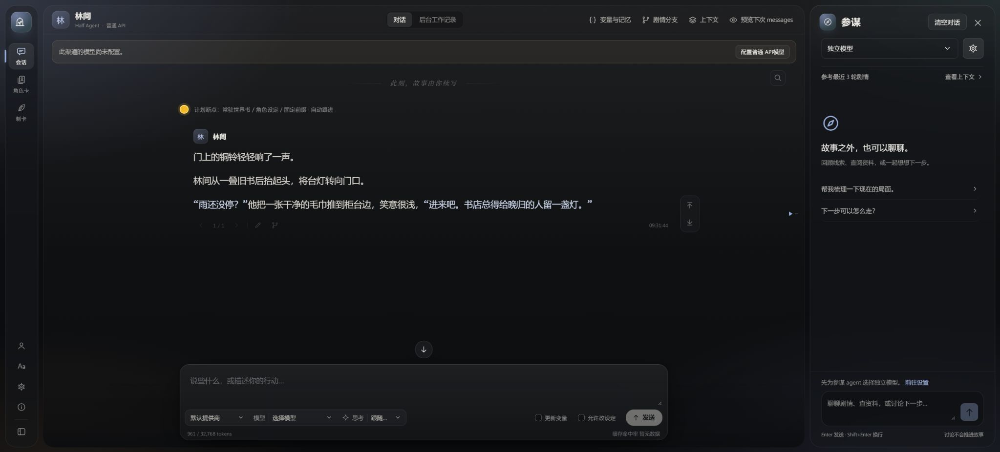
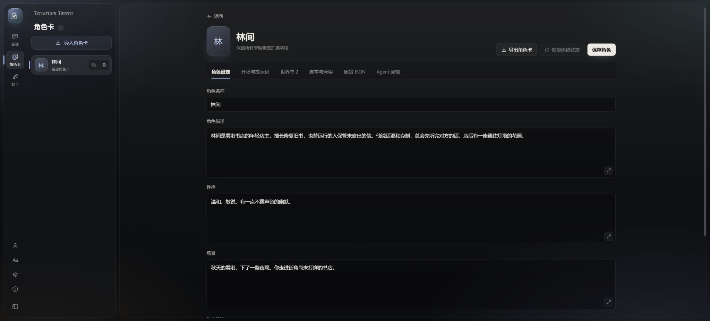
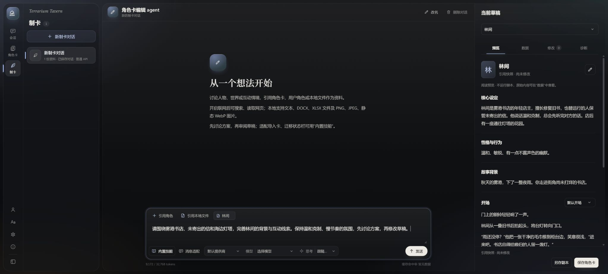

<div align="center">

# Terrarium Tavern

**本地优先的长篇角色扮演应用**

在有限的上下文里，让设定与故事保持连续。

[](#快速开始)
[](pyproject.toml)
[](package.json)
[](web)
[](src/tavern)
[](LICENSE/PROJECT_LICENSE.md)
[](docs/changelog.md)
[](#当前局限)

[版本记录](docs/changelog.md) · [主要功能](#主要功能) · [运行模式](#两种运行模式) · [快速开始](#快速开始) · [上手指南](#上手指南) · [当前局限](#当前局限) · [文档](#文档与开发) · [许可](#许可与致谢)

</div>

<br>

<p align="center">
  
</p>
<p align="center"><sub>示例角色卡「雾港来信」的开场，右侧可与参谋 agent 讨论剧情</sub></p>

<details>
<summary><b>查看角色卡编辑界面</b></summary>
<br>
<p align="center">
  
</p>
<p align="center"><sub>角色设定、开场、世界书和脚本在同一编辑页中管理</sub></p>
</details>

<details>
<summary><b>查看制卡对话界面</b></summary>
<br>
<p align="center">
  
</p>
<p align="center"><sub>角色卡编辑 agent 的制卡工作区：引用角色资料、准备需求与预览草稿（待发送）</sub></p>
</details>

---

## 简介

Terrarium Tavern 是基于 [Kohaku Terrarium](LICENSE/KohakuTerrarium.txt) 的本地角色扮演应用，兼容 SillyTavern 的部分角色卡与世界书格式。

项目围绕**长篇互动叙事**设计，提供角色卡管理、世界书检索、剧情分支和故事记忆，探索如何在有限的上下文中维持设定与故事的连续性。剧情与配置默认保存在本机。

> [!NOTE]
> 当前版本为 **v0.5.0**，仍处于**实验阶段**，支持 Windows 10/11 与 Linux（Bash）。版本变化与升级注意事项见[版本记录](docs/changelog.md)。

## 主要功能

<table>
<tr>
<td width="33%" valign="top">

### 按剧情检索世界书

结合关键词、BM25 全文检索，以及可选的本地向量检索与重排。相关条目插入触发它的对话位置，随对应剧情保留或退出上下文。

</td>
<td width="33%" valign="top">

### 管理角色卡与故事

支持文本角色卡，以及带 HTML 界面和 MVU 变量的角色卡。可编辑剧情、重新生成回复，并从任意选定进度创建独立分支。

</td>
<td width="33%" valign="top">

### 透明的生成过程

预览上下文中的剧情、设定与记忆，在工作记录中查看检索和整理过程。参谋 agent 协助查阅剧情与资料，角色卡编辑 agent 协助修改草稿和适配卡片。

</td>
</tr>
</table>

## 两种运行模式

创建故事时可选择运行模式，两者各自独立配置模型与参数。

| | **Half Agent** | **Full Agent** |
|:--|:--|:--|
| **分工** | Writer 专注正文，后台 Tracker 维护记忆与变量 | 单一 Agent 通过工具完成检索、笔记、变量与正文 |
| **记忆** | 按周期积累分类记忆，可查看来源并手工修订 | 自行维护笔记，跨上下文窗口时通过交接笔记续接 |
| **特点** | 写作与工具操作分离，Writer 不调用工具 | 独立实验路线，叙事质量仍待验证 |
| **说明** | [窗口与记忆](docs/guides/history-maintenance-settings.md) | [使用指南](docs/guides/full-agent.md) |

## 快速开始

### 环境要求

| 依赖 | 版本 | 说明 |
|:--|:--|:--|
| Python | — | 安装脚本通过 uv 自动准备 Python 3.12 与锁定依赖 |
| Node.js | 22+ | 用于构建前端 |
| Git | — | 克隆仓库；也可直接下载并解压源码 |
| NVIDIA GPU | 可选 | 仅本地向量检索与重排需要，须支持 CUDA |

### 安装并启动

在项目根目录运行安装脚本。脚本会准备 Python 环境与依赖、构建前端并下载 Chromium。

<details open>
<summary><b>Windows（PowerShell）</b></summary>

```powershell
.\setup.ps1 -Proxy ''
.\start.ps1
```

以上命令使用直连。需要代理时，将 `-Proxy ''` 改为 `-Proxy '<完整的 HTTP(S) 代理地址>'`。

</details>

<details>
<summary><b>Linux（Bash）</b></summary>

```bash
./setup.sh
./start.sh
```

默认沿用环境中的代理，也可通过 `--proxy '<完整的 HTTP(S) 代理地址>'` 指定。若 Chromium 提示缺少系统库，运行以下命令补齐（按系统提示提供 sudo 权限）：

```bash
.venv/bin/python -m playwright install-deps chromium
```

</details>

启动后访问 **[http://127.0.0.1:8000](http://127.0.0.1:8000)**。停止服务使用 `.\stop.ps1`（Windows）或 `./stop.sh`（Linux）。

> [!TIP]
> 默认检索使用关键词与 BM25，CPU 即可运行。如需本地向量检索与重排，安装时添加 `-LocalRetrieval`（Windows）或 `--local-retrieval`（Linux），再到应用设置中下载并预热模型。模型 API 的代理在应用设置中单独配置。

端口、数据目录、备份与升级见[安装与维护](docs/guides/maintenance.md)；本地模型配置见[世界书检索](docs/guides/retrieval.md)。

## 上手指南

1. **配置模型** — 在「设置 → 通用 → 提供商」添加连接，再到对应运行模式的「模型与生成」选择提供商和模型。Half Agent 的正文生成与后台整理分别配置；Full Agent 和 Tracker 的相关能力需要模型支持工具调用。普通参数自动保存，提示词通过绿色勾保存。
2. **导入角色卡** — 从侧栏「角色卡」导入文件。仓库附带两张示例卡：
   - [雾港来信](samples/雾港来信.json)：体验文本故事
   - [星航状态卡](samples/星航状态卡.json)：体验 HTML/MVU，使用前需启用该卡的脚本权限
3. **开始故事** — 点击「开始新故事」，选择角色卡、运行模式、模型渠道、用户身份和开场。变量更新与设定修改按界面提示授权。
4. **阅读与调整** — 在对话中续写行动，按需编辑、重生成或创建分支；通过上下文预览、记忆和工作记录查看故事状态。

**模型接入**支持 Chat Completions、Responses、Anthropic Messages 与 Gemini。API 连接与 ChatGPT 订阅接入的操作见[设置指南](docs/guides/settings.md)。

> [!IMPORTANT]
> 剧情、角色资源和模型配置默认保存在 `data/`。升级或迁移前请先备份该目录；ChatGPT 账号在换机后需要重新连接。

## 当前局限

本项目仍在探索中，以下是开发者目前的判断与已知不足：

| 方面 | 现状 |
|:--|:--|
| **角色卡编辑 agent** | 已提供草稿编辑、工作流适配、校验和保存流程，但交互打磨、复杂卡片理解及修改质量仍需完善。修改结果需人工审阅，尤其是初始化、脚本与世界书用途的调整。 |
| **角色卡兼容范围** | 当前适配了 SillyTavern 的部分格式与接口。扩展、远程脚本和复杂 MVU 卡片需逐卡确认，详见[兼容范围](docs/guides/compatibility.md)。 |
| **长篇叙事质量** | 开发者个人游玩初步确认中篇体验较好。模型选择、系统提示词和各项机制参数都会显著影响体验。 |
| **记忆系统对模型的要求** | 记忆整理涉及复杂判断和格式化输出。测试中 GPT-5.6-Luna 故障与错误率较高，正常运行至少需要 GPT-5.6-Terra 或相近能力的模型。 |
| **重型破限预设** | ST 社区的这类预设通常依赖情景诱导、角色伪装和前端显示处理。开发者认为沉重的提示词工程可能影响输出质量与 API 缓存命中率；破限功能不在长期开发范围内。 |
| **Half Agent 的 Agent 化程度** | 该模式有意将正文生成与工具操作分开。开发者观察认为，当前模型的 agent 与编程训练倾向可能让写作变得机械，因此保留这一分工。Full Agent 作为独立实验路线，实际叙事质量仍需验证。 |

## 文档与开发

完整的使用、设计与开发资料见 **[文档导航](docs/README.md)**。

| 使用指南 | 设计与开发 |
|:--|:--|
| [设置指南](docs/guides/settings.md) | [应用架构](docs/design/architecture.md) |
| [角色卡编辑](docs/guides/card-editor.md) | [项目目录](docs/development/structure.md) |
| [阅读、编辑与分支](docs/guides/story-history.md) | [开发、测试与发行](docs/development/validation.md) |
| [参谋 agent](docs/guides/advisor.md) | [回合工作流](docs/design/agent-workflow.md) |
| [世界书检索](docs/guides/retrieval.md) | [上下文生命周期](docs/design/context-lifecycle.md) |

### 技术栈

| 层级 | 技术 |
|:--|:--|
| 前端 | Vue 3 · TypeScript · Vite |
| 后端 | Python · FastAPI · SQLite |
| Agent 基座 | Kohaku Terrarium |
| 卡片脚本 | 在隔离的 Chromium 中运行 |

## 许可与致谢

本项目原创代码及随附原创资料采用 **[Terrarium Tavern 非商业许可 1.1](LICENSE/PROJECT_LICENSE.md)**，仅限非商业使用、修改和免费再分发，授权范围以许可全文为准。

Kohaku Terrarium 及其他第三方组件保留各自许可，详见[许可范围](LICENSE/README.md)。当前依赖中的 GPL／AGPL 许可兼容性仍有待解决，见[许可审查与发行边界](docs/development/licensing.md)。

特别感谢以下项目：

- **[Kohaku Terrarium](https://github.com/Kohaku-Lab/KohakuTerrarium)** — Agent 运行基座
- **SillyTavern** — 角色扮演工作流的参考
- **MagVarUpdate** — MVU 核心
- **Tavern Helper** — 脚本接口适配的参考

其他组件及贡献者见[第三方声明](LICENSE/THIRD_PARTY_NOTICES.md)。

<br>

<div align="center">
<sub>Powered by <b>KohakuTerrarium</b> · Copyright 2024–2026 Shih-Ying Yeh (KohakuBlueLeaf) and contributors</sub>
</div>
