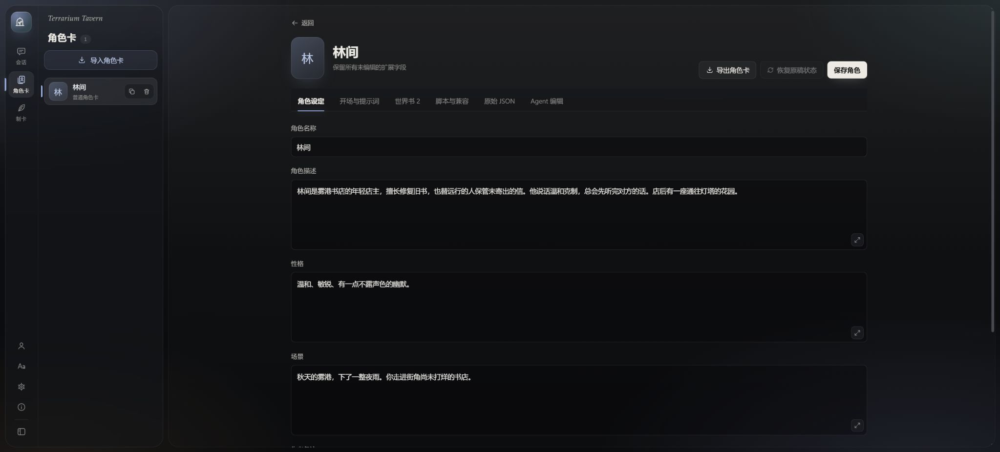
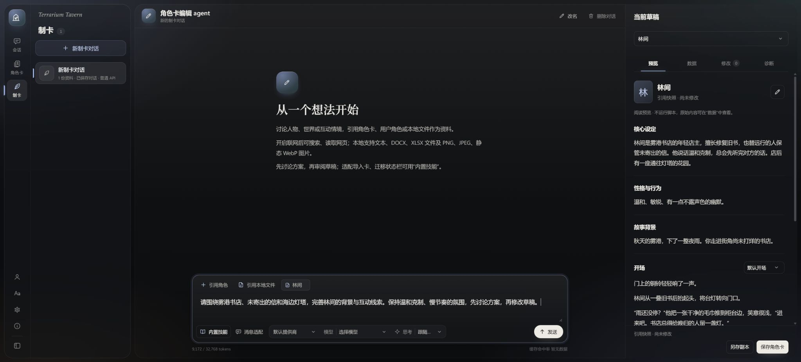

<div align="center">

# Terrarium Tavern

**本地优先的长篇角色扮演应用**

在有限的上下文里，让设定与故事保持连续。

[](#快速开始)
[](pyproject.toml)
[](package.json)
[](web)
[](src/tavern)
[](LICENSE/PROJECT_LICENSE.md)
[](docs/changelog.md)
[](#当前局限)

[版本记录](docs/changelog.md) · [主要功能](#主要功能) · [游玩](#游玩) · [快速开始](#快速开始) · [上手指南](#上手指南) · [当前局限](#当前局限) · [文档](#文档与开发) · [许可](#许可与致谢)

</div>

<br>

<details>
<summary><b>查看角色卡编辑界面</b></summary>
<br>
<p align="center">
  
</p>
<p align="center"><sub>角色设定、开场、世界书和脚本在同一编辑页中管理</sub></p>
</details>

<details>
<summary><b>查看制卡对话界面</b></summary>
<br>
<p align="center">
  
</p>
<p align="center"><sub>制卡 agent 的制卡工作区：引用角色资料、准备需求与预览草稿（待发送）</sub></p>
</details>

---

## 简介

Terrarium Tavern 是基于 [Kohaku Terrarium](LICENSE/KohakuTerrarium.txt) 的本地角色扮演应用，兼容 SillyTavern 的部分角色卡与世界书格式。

项目围绕**长篇互动叙事**设计，提供角色卡管理、世界书检索、剧情分支和故事记忆，探索如何在有限的上下文中维持设定与故事的连续性。剧情与配置默认保存在本机。

> [!NOTE]
> 当前版本为 **v0.8.16**，仍处于**实验阶段**，支持 Windows 10/11 与 Linux（Bash）。[GitHub Release](https://github.com/illuminatedworm/terrarium-tavern/releases/tag/v0.8.16) 提供 Windows x64 便携包和 Android ARM64 APK；便携包解压后双击 `点击开始.cmd`，需系统已有 Edge 或 Chrome。APK 为 debug 签名，要求 Android 9+、4 KiB 内存页。版本变化与升级注意事项见[版本记录](docs/changelog.md)。

## 主要功能

<table>
<tr>
<td width="33%" valign="top">

### 按剧情检索世界书

结合关键词、BM25 全文检索，以及可选的本地向量检索与重排。相关条目插入触发它的对话位置，随对应剧情保留或退出上下文。

</td>
<td width="33%" valign="top">

### 管理角色卡与故事

支持文本角色卡，以及带 HTML 界面和 MVU 变量的角色卡。可修改最新用户输入并重试、重新生成回复，并从任意选定进度创建独立分支；历史版本保留对应输入与状态。

</td>
<td width="33%" valign="top">

### 透明的生成过程

预览上下文中的剧情、设定与记忆，在工作记录中查看检索和整理过程。参谋 agent 协助查阅剧情与资料，制卡 agent 协助修改草稿和适配卡片。

</td>
</tr>
</table>

## 游玩

剧情模型在同一工具循环中检索世界书、维护笔记、执行授权的变量与设定修改，并交付剧情正文。模型通过交接笔记延续故事，Runtime 校验换窗、审核和回合提交。操作见 [游玩指南](docs/guides/story.md)。

## 快速开始

升级前请保留完整备份。导入旧数据包时，预览会标明因格式过旧而无法导入的故事。详见[安装与维护](docs/guides/maintenance.md#备份升级与回退)。

三种方式使用同一应用版本，按需选择：

| 方式 | 适用 | 需要准备 |
|:--|:--|:--|
| **Windows 便携包** | 直接游玩，无需开发环境 | Edge 或 Chrome 稳定版 |
| **源码安装** | Windows 或 Linux，跟进开发分支或自行修改 | Edge 或 Chrome 稳定版；安装脚本准备其余依赖 |
| **Android APK** | 在手机上本地游玩 | Android 9+、ARM64、4 KiB 内存页 |

桌面版使用系统已安装的 Microsoft Edge 或 Google Chrome 稳定版运行窗口与卡片脚本；只有 WebView2 Runtime 不够。

### Windows 便携包

1. 安装 Edge 或 Chrome 稳定版（Windows 10/11 通常已自带 Edge）。
2. 从 [GitHub Release](https://github.com/illuminatedworm/terrarium-tavern/releases/tag/v0.8.16) 下载 `terrarium-tavern-0.8.16-windows-x64.zip`，可用同名 `.sha256` 校验完整性。
3. 解压到一个可写的新目录，双击 `点击开始.cmd`。

便携包已含独立 Python、锁定依赖与界面，无需运行安装脚本。基础包不含 CUDA 检索依赖与模型权重；升级时解压到新目录，再用 `.\start.ps1 -Data '<原数据目录>'` 指向原数据目录或恢复备份，不要覆盖旧程序目录。

### 源码安装

| 依赖 | 版本 | 说明 |
|:--|:--|:--|
| Python | — | 安装脚本通过 uv 自动准备 Python 3.13 与锁定依赖 |
| Node.js | 22+ | 安装脚本默认下载固定版本二进制包（含 npm）；已有系统 Node 可加 `-SkipNodeDownload` / `--skip-node-download` |
| Git | — | 克隆仓库；也可直接下载并解压源码 |
| Microsoft Edge / Google Chrome | 当前稳定版 | 需先自行安装；安装脚本只检查，不下载 |
| NVIDIA GPU | 可选 | 仅本地向量检索与重排需要，须支持 CUDA |

在项目根目录运行安装脚本，再启动服务。开发工具链长期保存在 `desktop-dev/`，不要当作缓存清理；从旧版本升级后须重新运行安装脚本。

<details open>
<summary><b>Windows（PowerShell）</b></summary>

```powershell
.\setup.ps1 -Proxy ''
.\点击开始.cmd
```

以上命令使用直连下载。需要代理时，将 `-Proxy ''` 改为 `-Proxy '<完整的 HTTP(S) 代理地址>'`；省略 `-Proxy` 时沿用调用环境中的代理。

</details>

<details>
<summary><b>Linux（Bash）</b></summary>

```bash
./setup.sh
./start.sh
```

默认沿用环境中的代理，也可通过 `--proxy '<完整的 HTTP(S) 代理地址>'` 指定，`--proxy ''` 选择直连。需先使用浏览器官方安装包准备 Chrome 或 Edge 稳定版及其系统依赖。本次不提供 Linux 二进制包。

</details>

> [!TIP]
> 默认检索使用关键词与 BM25，CPU 即可运行。如需本地向量检索与重排，安装时添加 `-LocalRetrieval`（Windows）或 `--local-retrieval`（Linux），再到应用设置中下载并预热模型。

### Android APK

从同一 [GitHub Release](https://github.com/illuminatedworm/terrarium-tavern/releases/tag/v0.8.16) 下载 `terrarium-tavern-0.8.16-android-arm64-build9.apk` 安装。APK 内嵌 Python 后端与现有界面，数据保存在手机本地；使用 debug 签名，覆盖升级需签名一致，更新前先导出个人备份。本地向量与重排需单独导入固定的 Q8_0 GGUF 模型，GPU/NPU 加速另需 Android 14+。设备范围、构建方式与已知限制见 [Android APK](docs/development/android.md)。

### 启动之后

桌面版启动后访问 **[http://127.0.0.1:51273](http://127.0.0.1:51273)**。停止服务使用 `.\stop.ps1`（Windows）或 `./stop.sh`（Linux）。

- **浏览器选择**：Windows 优先 Edge、其次 Chrome；Linux 优先 Chrome、其次 Edge，启动时显示实际路径。可用环境变量 `TAVERN_BROWSER=msedge` 或 `TAVERN_BROWSER=chrome` 明确指定，见[系统浏览器](docs/development/desktop.md#系统浏览器)。
- **日文词典**：中英文检索不需要。含日文的故事首次检索时自动联网下载；离线使用请提前在「设置 → 通用 → 本地资源」导入，见[日文词典](docs/guides/retrieval.md#日文词典)。
- **代理**：安装脚本的代理只作用于安装过程。应用内代理默认为空，模型接口与资源下载的代理在「设置 → 通用 → 联网与代理」单独配置。

端口、数据目录、备份与升级见[安装与维护](docs/guides/maintenance.md)；便携包构建与平台要求见[桌面开发与便携包](docs/development/desktop.md)；本地模型配置见[世界书检索](docs/guides/retrieval.md)。

## 上手指南

1. **配置模型** — 在「设置 → 通用 → 提供商」添加普通 API 的连接，或在「OpenAI 官方」添加 SIWC 或 OpenAI 官方 API 连接。再到「游玩 → 模型与生成」选择提供商和模型。游玩模型需要支持工具调用。同一提供商的模型列表在各处共享。普通参数自动保存，提示词通过绿色勾保存。
2. **导入角色卡** — 从侧栏「角色卡」导入文件，或从空白卡开始编辑。仓库附带两张示例卡：
   - [雾港来信](samples/雾港来信.json)：体验文本故事
   - [星航状态卡](samples/星航状态卡.json)：体验 HTML/MVU，进入故事前需启用该卡的脚本权限
3. **开始故事** — 点击「开始新故事」，按三步完成：选择角色卡 → 在「用户与开场」中设定对话渠道、用户身份并选择开场 → 按需挂载[世界书库](docs/guides/worldbooks.md)中的世界书。角色卡可预设新建对话默认使用的用户角色与世界书。
4. **调整开场** — 在首次模型任务（生成、参谋 agent 咨询或上下文整理）开始前，可点击开场白旁的「编辑」修改开场原文；保存只影响当前对话，并重新初始化开场变量和脚本状态。任务开始后开场白永久锁定。
5. **阅读与调整** — 在对话中续写行动，按需修改最新用户输入并重试、重生成或创建分支；通过上下文预览、记忆和工作记录查看故事状态。变量更新与设定修改按界面提示授权。

**模型接入**支持 Chat Completions、Responses、Anthropic Messages 与 Gemini。API 连接与 Sign In With ChatGPT（SIWC）的配置方法见[设置指南](docs/guides/settings.md)；编辑与分支规则见[阅读、编辑与分支](docs/guides/story-history.md)。

> [!IMPORTANT]
> 剧情、角色资源和模型配置默认保存在 `data/`。升级或迁移前请先备份该目录。回退旧程序须恢复升级前的备份。ChatGPT 账号在换机后需要重新连接。详见[备份、升级与回退](docs/guides/maintenance.md#备份升级与回退)。

## 当前局限

本项目仍在探索中，以下是开发者目前的判断与已知不足：

| 方面 | 现状 |
|:--|:--|
| **制卡 agent** | 已提供草稿编辑、工作流适配、校验和保存流程，但交互打磨、复杂卡片理解及修改质量仍需完善。修改结果需人工审阅，尤其是初始化、脚本与世界书用途的调整。 |
| **角色卡兼容范围** | 当前适配了 SillyTavern 的部分格式与接口。扩展、远程脚本和复杂 MVU 卡片需逐卡确认，详见[兼容范围](docs/guides/compatibility.md)。 |
| **长篇叙事质量** | 开发者个人游玩初步确认中篇体验较好。模型选择、系统提示词和各项机制参数都会显著影响体验。 |

## 文档与开发

完整的使用、设计与开发资料见 **[文档导航](docs/README.md)**。

| 使用指南 | 设计与开发 |
|:--|:--|
| [设置指南](docs/guides/settings.md) | [应用架构](docs/design/architecture.md) |
| [游玩指南](docs/guides/story.md) | [剧情架构](docs/design/story.md) |
| [制卡与角色卡编辑](docs/guides/card-author.md) | [制卡 agent 设计](docs/design/card-author.md) |
| [阅读、编辑与分支](docs/guides/story-history.md) | [项目目录](docs/development/structure.md) |
| [参谋 agent](docs/guides/advisor.md) | [开发、测试与发行](docs/development/validation.md) |
| [世界书检索](docs/guides/retrieval.md) | |

### 技术栈

| 层级 | 技术 |
|:--|:--|
| 前端 | Vue 3 · TypeScript · Vite |
| 后端 | Python · FastAPI · SQLite |
| Agent 基座 | Kohaku Terrarium |
| 卡片脚本 | Playwright 驱动系统 Edge / Chrome，在隔离环境中运行 |

## 许可与致谢

本项目原创代码及随附原创资料采用 **[Terrarium Tavern 非商业许可 1.1](LICENSE/PROJECT_LICENSE.md)**，仅限非商业使用、修改和免费再分发，授权范围以许可全文为准。

Kohaku Terrarium 及其他第三方组件保留各自许可，详见[许可范围](LICENSE/README.md)。当前依赖中的 GPL／AGPL 许可兼容性仍有待解决，见[许可审查与发行边界](docs/development/licensing.md)。

特别感谢以下项目：

- **[Kohaku Terrarium](https://github.com/Kohaku-Lab/KohakuTerrarium)** — Agent 运行基座
- **SillyTavern** — 角色扮演工作流的参考
- **MagVarUpdate** — MVU 核心
- **Tavern Helper** — 脚本接口适配的参考

其他组件及贡献者见[第三方声明](LICENSE/THIRD_PARTY_NOTICES.md)。

<br>

<div align="center">
<sub>Powered by <b>KohakuTerrarium</b> · Copyright 2024–2026 Shih-Ying Yeh (KohakuBlueLeaf) and contributors</sub>
</div>
