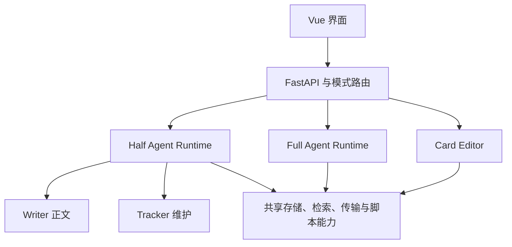

# 应用架构与职责

应用提供 Half Agent 和 Full Agent 两种游玩模式，另有独立的角色卡编辑 agent 工作区。本文说明共享层与 Half Agent 的职责；Full Agent 的模型循环见[独立设计](full-agent.md)，Card Editor 见[编辑工作区](card-editor.md)。

## 正式角色与职责

| 角色 | 职责 | 代码入口与边界 |
|---|---|---|
| Writer | 演绎角色、生成正文及检索线索 | [scripting/agent.py](../../src/tavern/scripting/agent.py) 的 `Writer`；常规正文一次生成，零工具，不调度 Tracker 或提交状态 |
| Tracker | 分类记忆、授权对话设定和 MVU 变量维护 | [tracker/workflow.py](../../src/tavern/tracker/workflow.py) 调度，[tracker/task.py](../../src/tavern/tracker/task.py) 执行原生工具循环；工具按本轮任务授权 |
| Card Editor | 独立编辑和适配角色卡草稿 | [character/card_editor.py](../../src/tavern/character/card_editor.py)；不读取剧情，用户审阅后保存书架卡片 |
| Half Agent Runtime | 回合、检索、上下文、窗口、脚本、审核和提交 | [application/service.py](../../src/tavern/application/service.py) 的 `RoleplayRuntime`；程序编排者 |
| 模式路由 | 将故事操作交给对应引擎 | [application/modes.py](../../src/tavern/application/modes.py)；Full Agent 不调用 Writer／Tracker 编排 |

Writer 和 Tracker 通过 Runtime 管理的回合草稿交换数据，不直接委派。前置任务处理必要的裁剪补整理及明确设定修改，后置任务合并到期记忆与授权变量维护。调用限额见[Half Agent 设置](../guides/history-maintenance-settings.md#记忆与任务限额)。

`scripting/agent.py` 的 `TurnAgent` 适配 Writer 与 Terrarium；[scripting/runtime.py](../../src/tavern/scripting/runtime.py) 的 `ScriptRuntime` 执行隔离卡片脚本，不能与 `RoleplayRuntime` 混淆。

## 数据所有权与事务

SQLite 是剧情和状态的权威来源。消息通过父节点构成历史，快照保存状态、记忆、世界书注入、脚本变量与对话设定草稿。完成正文处理与回调后，消息、快照、会话 head/revision 和提交事件在同一事务中生效。

| 机制 | 约束 |
|---|---|
| `operation_id` | 会话内幂等；相同操作及内容返回原结果，不重复执行 |
| `expected_revision` | 乐观并发检查，拒绝覆盖已变化的会话 |
| 回合互斥 | 一个会话只允许一个运行或待审核回合 |
| SSE | 观察执行，不控制生命周期；断开不取消生成 |
| 前端请求归属 | 按事件序号去重，切换会话后忽略旧请求响应 |

书架角色卡保存使用 revision。创建故事时复制角色资料、脚本权限和依赖清单，书架后续保存或删除不改变旧故事。编辑草稿和副本共同保护引用资源。

独立分支复制可见消息前缀和快照，重映射记忆来源及世界书锚点；删除源会话不影响分支。编辑原文保留已有记忆并标记来源变化，同时使相关线索和窗口失效；它不自动重演变量。操作语义见[工作流](agent-workflow.md#操作边界)。

## 设置与恢复

设置文档按 `full_agent`、`half_agent` 和 `shared` 持久化，运行时使用一次操作的配置快照。Writer、Tracker、Full Agent 和 Card Editor 各有明确模型配置。界面“后台工作记录”汇集 Runtime 事件，不只包含 Tracker 请求。

数据库为 schema 3，打开前检查格式；schema 1/2 先备份再迁移，未知版本不执行建表。设置字段及迁移见[设置 API](../reference/settings-api.md)。

剧情快照持续保留，恢复和回复版本切换使用对应快照。详细诊断可以清理，但剧情、分支及恢复所需记录不作为旧日志删除。存储策略见[安装与维护](../guides/maintenance.md#清理与资源保留)。

## 上下文与模型传输

检索器输出最终候选、准入证据和递归结果。Half Agent 窗口规划与编译消费同一清单，编译器不自行增加候选。中途世界书占 token 容量，不占剧情条数；退出原文前由 Tracker 校验整理覆盖。

Writer 每回合建立无工具 Creature，关闭基座自动 compact；Tracker 使用独立工具上下文。通用管理工具不进入模型白名单。最终 HTTP 请求统一检查协议和内容占用，本地超量估算遵循[文本完整性](text-integrity.md)。

模型业务输入使用[数据边界](model-data-boundary.md)定义的自然语言投影和短引用。持久身份、指纹、schema 与初始化账本留在运行时；原始快照仍保存完整数据。

两种模式共用 [模型传输](../reference/model-api.md)，分别管理原生回复和动态上下文记录。固定依赖版本和最终请求序列化测试共同保护升级。

## 脚本与资源隔离

角色 HTML 运行于不含 `allow-same-origin` 的 sandbox iframe，桥接检查来源窗口和随机通道。服务端脚本 realm 阻止网络，不接触 API 密钥，每回合重新建立；持久数据必须通过变量 API 保存。

外部依赖先下载、哈希缓存和离线打包。卡级缓存及已落盘的旧会话依赖可以复用，解析后回填卡级清单；每个故事仍有自己的依赖清单。运行阶段不任意联网，兼容范围见[矩阵](../guides/compatibility.md)。

服务只监听 loopback，并校验 Host/Origin。密钥保存在后端本地配置，设置响应不返回密钥原文；备份包含密钥，应按私有数据保管。窗口、日志、索引和模型权重有不同生命周期。
