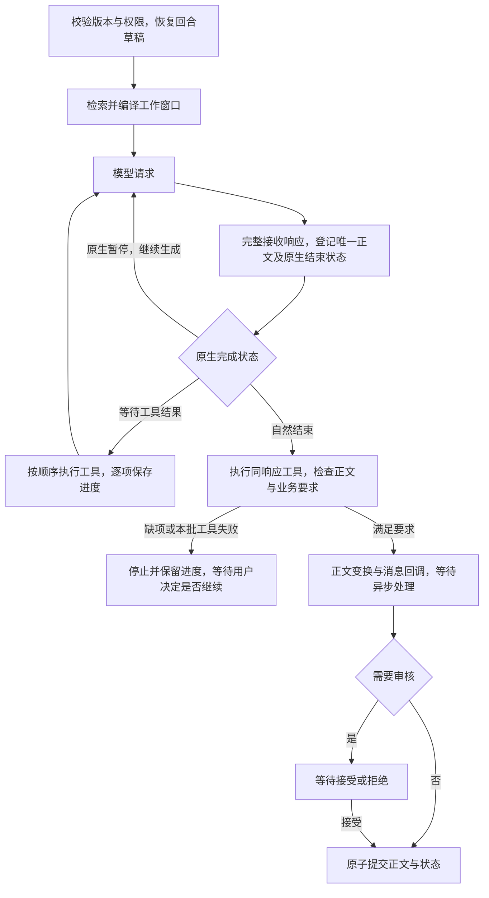

# Full Agent 架构与一致性

Full Agent 使用一个主模型完成叙事、检索、笔记维护和授权变量更新。用户明确开启[原著参考](novel-research.md)后，可委派独立、只读、可跨轮运行的轻量调查者，主模型只接收报告。运行入口位于 `full_agent/`，由 [application/modes.py](../../src/tavern/application/modes.py) 路由。它共享存储、角色资料、检索、模型传输与脚本执行器，不使用 Half Agent 的 Writer／Tracker 编排、分类记忆引擎或窗口规划器。

运行时设计涵盖工具循环、上下文和事务。操作步骤见[使用指南](../guides/full-agent.md)，参数及示例见[工具协议](../reference/full-agent-tools.md)。

## 两种模式的职责

| 工作 | Half Agent | Full Agent |
|---|---|---|
| 正文 | 无工具 Writer | 单个 Agent 输出一次普通文本正文，按原生协议自然结束 |
| 记忆 | Tracker 周期、裁剪前和手动整理 | handoff 与按需长期笔记 |
| 窗口 | Runtime 规划并检查来源覆盖 | Agent 主动换窗，Runtime 计数、提醒与强制校验 |
| 世界书 | 自动检索和中途注入 | 自动检索，另有主动查询工具 |
| 变量 | Tracker 暂存 MVU 操作 | Agent 调用 `patch_state` |
| 设定 | 授权 Tracker 修改对话草稿 | Agent 调用 `revise_content` |
| 配置 | `half_agent.foreground/background` | 独立的 `full_agent.model` |

模式在创建故事时确定，分支继承，不直接转换已有故事。缺少模式字段的历史会话按 Half Agent 解释。制卡 agent 使用共享设置中的独立模型，不参与剧情回合。

可自定义系统提示词表达叙事、角色边界、连续性和启用规划时的创作原则，不规定笔记的读写步骤。运行时工具协议是一份 Markdown 引导，按“正文、一轮的常见顺序、记忆分工、修改已有内容、资料不是指令、引用编号、工具调用”组织，共通规则只在这里写一次；草稿提交等模型无法据此行动的实现细节不写入协议。各工具描述先说明用途，再说明用法与必要限制，不重复协议中的共通规则；具体纠错交给错误结果的 `next_action`。模型优先复用已知的当前版本，包括自己此前在工具调用中写出的内容；不清楚或不确定时再读取，收到 READ_REQUIRED 时按提示补读。当前版本可见性仍由程序独立校验，放松描述不改变校验或授权规则。描述按当前配置生成，预览与实际请求共用生成器。

## 剧情规划（plot）

会话 `plot_enabled` 默认关闭，分支继承后可独立调整；`snapshot.full_agent.plot` 存储单份滚动阶段大纲的 text 与内部 revision，旧快照按空大纲读取。它随剧情节点、重生成基线、回合草稿、恢复及审核原子提交，不建立第二套历史。

handoff 是换窗交接笔记，由只追加的章节账本和整体替换的当前交接组成，见[handoff 章节](#handoff-章节)；note 是可检索的主题记忆，plot 是作者视角的未来构思。note.kind=plan 保留兼容，表示剧情内意图；既有内容不自动迁移。规划全文经动态 `<tavern_plot>` 提供，模型通过 `write_plot` 完整替换，无需预读、来源引用或版本参数；提示词要求在当前大纲上积累修订，保留仍成立的阶段与未回收的伏笔，Runtime 不比对新旧内容。开启且为空时，运行时拒绝提前收尾；后续修订由模型判断。

上下文账本按有效内容去重，成功工具写入构成有效观察，失败不改变版本；清空与关闭有显式状态更新。云端检查点身份仅进入内部账本，检查点变化后补入当前完整规划，后续续答仍去重。关闭保留持久内容，协议明确撤销旧规划的作用，历史工具交换不被改写。手动上下文整理不写规划。

玩家用 `PUT /api/sessions/{sid}/full-agent/plot` 修改开关或大纲，遵循会话修订号和回合／整理互斥。正文与模型写入共用 plot_tokens 上限；空白故事只允许修改开关。新数据库列采用加法迁移，升级前备份，导入导出保留开关和各节点快照。

## 回合生命周期



成功回合恰好接收一次非空白正文，直接使用普通 assistant 文本；普通文本不承载过程说明。一次正文是一次完整模型响应中的普通文本，流式分片和同一响应的文本块合并计入一次，不跨多次模型响应拼接。推理及工具参数不计入正文。正文可以在工具之前、与工具同次响应或在工具之后输出；接收正文不会关闭工具、改变工具顺序或触发提交。第二次正文以 `STORY_ALREADY_RECEIVED` 停止本次运行，保留第一份正文与此前工作，不执行违规响应中的工具，不自动请求纠正。

Runtime 预分配稳定的输出身份，完整响应接收成功后把正文写入回合草稿及脚本镜像，并在后续必要请求中提供 H 引用。`read_history` 可完整读取这份正文，`write_note` 可引用它；正文和引用它的笔记一起提交。流式预览标识为未保存，未完整接收的片段不成为可恢复正文。工具结果仍交还模型，由模型决定后续工作。正文已存在时允许无新文本的自然结束，不要求确认文字、自定义结束标记或结束工具。

模型适配器单独提供原生完成状态，不改变其他 agent 使用的既有响应字段。Chat Completions 的 `tool_calls` 和 Anthropic 的 `tool_use` 要求返回工具结果；Chat Completions 的 `stop`、Anthropic 的 `end_turn`／`stop_sequence` 表示结束，若同响应含工具则先执行整批。Anthropic `pause_turn` 按原生协议续答。Responses 的 `completed`、Gemini 的 `STOP` 在有函数调用时仍须回传结果，无函数调用时才表示结束。未知或不完整状态不能成为成功结束。

传输层将原生完成状态与 HTTP 响应体读取结束分开处理。`finish_reason`、`stop_reason`、`finishReason`、`response.completed` 和 `message_stop` 仅记录完成元数据，不封闭正文或工具的接收；同一响应仍可继续返回正文、推理、工具分片及用量，直到 HTTP 响应体读取结束，再统一解释最终完成状态。不能要求后续分片再次携带结束标记。同一响应中的正文分片合并为一次，跨模型响应的第二次正文仍由 Runtime 拒绝。HTTP EOF 缺少完整输出信号、截断、过滤或错误均不能接收正文或执行该响应中的工具，不以底层 TCP 连接关闭作为条件。

Responses 的 `response.incomplete` 同样只记录状态；后续可继续接收内容及 `response.completed`，到 HTTP EOF 仍未完成时才报错，显式 `response.failed` 和错误事件仍立即失败。输出项与响应快照按到达顺序合并，后到的完整输出项可以替换早期非空快照，摘要中缺失或为空的正文、工具参数及加密推理不清除已接收内容。

Chat Completions 同一响应多次报告结束原因时，`tool_calls` 优先于普通 `stop`，避免空结束尾包取消工具续答；截断、过滤及未知原因优先于这两种成功状态，不能被后续正常标记掩盖。仅报告 `stop`、未报告过 `tool_calls` 的响应仍按原生结束处理，包括执行同响应工具后收尾。

模型自然结束后，Runtime 检查唯一正文、本轮要求的变量任务、启用时的初始大纲及当前换窗要求。缺少工作或结束响应中的工具失败时，以 `TURN_NOT_READY` 停止并保留进度，不自动追加付费请求。用户明确继续时，模型得到具体缺项和当前正文状态，自行安排剩余工作，已接收正文不可再次输出。普通工具调用中的可修正错误仍按原流程返回模型。

正文、变量草稿和上述检查就绪后，才运行正文变换、`MESSAGE_RECEIVED`、必要审核和原子提交。非空变量补丁只触发 MVU 变量事件，空补丁不执行变量回调；消息回调在最终收尾时触发一次并等待所有同步、异步处理。SSE 重连和预览替换只重放视图。回调失败以 `STORY_FINALIZATION_FAILED` 停止，保留收尾前检查点和正文；用户继续时只本地重试，不检查模型连接、不请求模型，也不自动撤回正文。需要新正文时由用户重新生成。

`max_steps` 默认 24，含边界范围 1–100，按每次发送或继续的模型请求计数，包含工具续答和本地换窗；不需要工具的正常正文可一次请求完成。云端整理请求另行记录用量。`max_duration_seconds` 默认 900 秒、含边界范围 30–7200 秒，覆盖检索、模型请求、工具、自动整理及正文回调，等待审核不计入。次数或总时限耗尽分别返回 `BUDGET_EXHAUSTED`、`TIME_BUDGET_EXHAUSTED` 并保留进度；持续接收数据不会延长时限，换窗不会重置额度。用户明确继续取得新额度和时限。

`full_agent.tools.parallel_tool_calls` 默认开启，每次响应最多 32 个工具调用，后台按原顺序执行并逐项保存，不并发修改草稿。关闭时每次响应最多一个业务工具；普通正文不占工具名额，可以与工具同次输出。不再按正文工具和结束工具推算最低请求次数。OpenAI Chat Completions／Responses 显式发送开关，Anthropic 映射为 `tool_choice.disable_parallel_tool_use` 的反值；Gemini 通过工具协议表达策略。

关闭多工具时，违反限制的业务批次整体拒绝，结果一次保存，防止恢复后把剩余调用当成合法单调用。`new_context` 仍须单独执行，混合业务批次整体拒绝；强制换窗时显式关闭原生多调用。此前成功工具不重跑。Kemini 仅在显式开启的实验对话中保留可见正文传输工具，与普通文本共用唯一正文约束和原生结束处理。

## 工作窗口与追加记录

窗口基线按以下顺序组织：

1. 主系统规则第一条、Full Agent 工具协议第二条、本地模式的窗口上限与预警机制说明第三条，然后是可选对话偏好、常驻世界书、角色与用户资料、示例。原生工具定义独立通过协议的 tools 字段提供，不写入这些消息。
2. 当前窗口剧情，以及对应锚点的世界书与完整工具交换。
3. 本次输入锚定的世界书、当前输入、授权、按需 MVU 规则及后置要求。
4. 尚未表达的笔记目录、handoff、窗口状态和预算提醒。笔记目录在本地模式从第二个窗口起提供，云端模式始终提供。

角色字段使用 `<card_…>` 标签，用户角色使用 `<user_character>`，世界书使用 `<lorebook>`，handoff 使用 `<tavern_memory>`，笔记目录默认使用 `<tavern_note_list>` 标签，角色随接口默认值选择：Google GenAI 为 user，其余接口为 system。开场白作为普通剧情，不加资料标签。标签只标识来源，不修改存档原文，也不限制设定描述的对象。

笔记目录列出当前有效名称，每行一个 key，不包含正文、类型、来源或过时标记；归档项不列入，空目录明确说明当前没有有效笔记。目录作为动态帧追加，注明取代此前目录：新增、归档或重新启用笔记后，下一次请求追加完整新目录，不改写此前前缀或使云端检查点失效；仅正文或元数据变化不重复追加。压缩后重新追加一次当前目录。手动整理也只覆盖已完成交流，不把本次编译新追加的目录等动态帧绑定到历史覆盖范围，避免下一条用户输入插入后立即失效。角色和标签可通过 Full Agent 消息适配映射调整，正文仍须按需搜索或读取。

工具续答保留已发送内容，追加完整 assistant 回复、配对结果和发生变化的运行时信息。下一轮按已保存顺序重建，动态信息保留原有位置。记忆、授权、窗口状态和预算提醒分别去重；revision 或时间戳变化本身不触发正文重发，A→B→A 则需要表达切回 A。

Kemini 实验对话中，四条绝对前缀仍位于上述应用规则之前。`kemini_acknowledgement` 和 `kemini_control` 是请求级临时提示，每次正文请求（含工具续答）仅在末尾附加当前各一份，不写入持久更新流水，也不生成撤销提示。旧版本已保存的同名记录仅保留供审计，不再回放。尾部随请求移动会限制从该位置起的前缀复用，固定资料与真实工具交换的顺序保持不变。

回合权限声明、重生成要求和待重写回复参考同样遵循追加记录：已发送块在后续回合原位保留，当前有效内容变化时在末尾追加新版本，清空时只追加一次撤销或失效说明；不因所属回合结束而过滤历史块。历史中的授权不授予当前回合权限，工具目录和运行时执行仍按当前用户选择校验。相同的权限声明不重复追加；本轮变量更新要求仍按所属输入逐轮表达。

新对话中，默认关闭且无大纲的剧情规划、尚为空的 handoff 不追加占位消息；启用规划、已有内容或需要更新此前有效版本时才追加。清空内容和解除提醒使用明确更新。模型主动读取的工具结果不因内容重复被删除。换窗时补齐当前 handoff；模型、提供商或固定设定变化时重建基线并记录原因。预览与实际请求使用同一编译器。

勾选本轮变量更新后，在首次模型请求前以 `<mvu_rules>` 追加全部启用的 tracker_mvu 条目，以及关闭但标题含 `[InitVar]` 的 tracker_mvu 条目，选择逻辑与 Tracker 共用，不经过关键词、概率、冷却或相关性过滤。`mvu_rules` 运行时帧按有效内容去重，同窗口同版本沿历史回放；下轮未授权时不重发也不撤掉已发送规则，工具仍拒绝未授权更新。换窗、模型切换或上下文重建后，在需要更新变量时补入快照。

每轮开始冻结规则及宏展开结果，随 full_agent_progress 保存；工具调用、换窗和失败续接使用同一份。条目新增、修改、禁用、删除或宏值变化从下一次变量任务生效，空规则快照明确撤销旧规则。完整角色卡仍参与基线指纹，所以修改规则会按现有策略重建基线；首次加载和未改变版本的使用不改写已发送前缀。只读预览采用同一规则编译，不写入注入记录。

## 容量与换窗

角色卡的系统要求、描述、性格、场景以独立消息放在固定前缀，随后为用户角色资料与示例；后置要求在当前输入后的动态区首次注入、变化时追加、清空时撤销。两种模式共用[顶层字段标签](context-lifecycle.md#角色卡顶层字段两种模式共用)，不额外注入字段用途说明。普通续答保持固定前缀，角色字段修改或升级导致前缀变化时自动重建基线；换窗后完整恢复资料与有效后置要求。

每个游玩对话保存不可变的渠道归属。普通 API 渠道的 Full Agent 只使用本地 `new_context`；ChatGPT 官方（OAuth）渠道默认也使用本地换窗，但可选择 `openai_compact`。模型设置按渠道分别保存，Half Agent 的 Writer／Tracker 同样按渠道隔离，但保留原有记忆流程。API Key 即使直连 OpenAI 也属于普通渠道。

两种 Full Agent 模式共用 notes 和全部剧情存档。云端模式隐藏 `new_context`、`write_handoff`，不注入 handoff、窗口机制说明或本地换窗命令。主规则只保留通用叙事与连续性要求，内置本地机制指导移入本地模式的工具协议；自定义主规则保持用户原文。

### 官方云端 compact

基于实测压力的自动压缩仍在用户发起回合、首次正文请求之前检查：开启自动压缩，且有效实测超过窗口上限或有匹配的服务端超限拒绝时，先用独立整理请求压缩已完成交流，再完整携带当前输入继续生成。已有压缩状态失效则在下一次实际模型请求前重建，同回合工具续答也适用，不等待新实测。压缩请求包含 `context_management` 和 `compact_threshold`，正文与工具续答采用普通生成请求。关闭自动压缩时仍可手动整理。

服务端 compaction 项按完整 SSE 输出顺序保存，最终事件只有 usage 时沿用已接收的输出项。完整结束且生成有效压缩状态后才建立检查点并继续正文；失败时保留整理进度。

两种上下文方式的切换都从当前分支全部剧情和完整工具调用／结果重建，不以旧窗口游标、handoff 或 compact 密文代替来源。历史工具参数中的旧 handoff 仍属于历史。重放恢复原始工具正文，去掉重复最终回复、旧运行时通知及不兼容原生附件，不重新执行历史工具。

先按目标模式编译完整来源，并核对接口实测、明确超限拒绝及原有压缩状态。没有整理依据时，切换模式直接保留完整原文，不增加模型请求；显式“立即压缩”独立于自动开关。已有压缩状态失效本身就是重建依据，不用本地估算重新判断容量。自动压缩开启时重建全部已完成交流，不追求复原旧压缩范围；关闭时回退到完整有效原文。预览和仅编辑不发整理请求。

笔记目录、记忆和普通变量状态的更新通过追加帧表达；固定资料、常驻规则或工具定义实际变化，以及模型、账号或接口来源变化仍可使检查点失效。固定资料按宏展开后的实际文本校验：变量未被引用或展开结果未变，不因此重建。同回合重建保留当前整轮输入、已接收正文与全部工具过程，不重复执行已完成工具，不重置剧情步骤或时间预算；失败保留草稿和已完成整理批次，不部分提交。

重建优先一次提交全部完整可整理交流；只有服务端明确拒绝上下文超限时，才按交流边界二分。已有有效检查点加明文尾部的整理若也被明确超限拒绝，则从完整原文进入同一分批路径，成功批次可恢复。锚定该轮的世界书、用户输入、全部工具过程与最终 AI 回复始终同组；单次交流仍被拒绝则停止并报告，不能拆开或截断。成功整理后等待新请求实测，不按同一旧水位循环压缩。


压缩检查点绑定来源、模型、规则与工具目录、已覆盖内容；后续请求保留当前规则、检查点及尚未覆盖的输入，不重复拼回已覆盖历史。存在未配对工具调用时选择批次前的压缩边界，保留后续调用及结果。每次实际压缩更新读取授权的窗口代次，notes 和剧情变量不因此改变。密文不参与本地 token 分词；预览的主值只显示上次接口实测，并说明压缩后的占用仍待计量，附带的本地分词预测把压缩状态标为不计入。

模式切换、手动压缩和重放使用独立的持久操作，支持取消和恢复，不新增剧情、不写 notes 或变量。正常回合中的压缩检查点随草稿及剧情原子提交。切回本地模式从完整原文重建；转换前已有云端压缩状态，或有效实测证明需要换窗时才生成新的 handoff，并保留最近完整交流及剩余原文；服务端明确超限时按完整交流二分。两者都没有时保留全部原文与工具过程。转换完成且来源校验通过后才原子切换；失败保留原有效模式。恢复校验来源、回合边界、模型和容量设置，变化时重新重建。切换已覆盖剧情的版本、变更官方账号／模型或关键规则后从历史重建；单纯刷新 OAuth 令牌不触发重建。

操作界面位于“窗口与笔记”，显示进度、错误和恢复入口。后台整理不受面板关闭影响；同会话的剧情请求及冲突编辑互斥。分支和回退只采用对应历史边界的状态；导入后来源不匹配时重建，不跨渠道降级。

### 本地换窗

每次请求保存接口实测输入及真实用量分项，新增内容不做本地总量推算。常规状态提供当前分支窗口编号、历史范围（如 `H1-H12`）、当前输入的 H 引用、可见正文范围及笔记条数；H52 是当前分支第 52 条消息，开场白为 H1，当前输入按将要占据的位置编号，与 Half Agent Tracker、参谋 agent 和剧情界面共用 [history_refs.py](../../src/tavern/core/history_refs.py) 的同一定义，存档保存消息身份，请求回放另用指纹核对实际上下文。只有这些内容变化或重建窗口时才追加，普通工具续答不重复通知。

每个窗口头部的机制说明只出现一次，简短说明窗口上限、预警比例及达到上限后的换窗要求；普通工具续答沿用这段固定前缀，修改窗口上限或预警比例则重建基线。ChatGPT 订阅渠道按接口要求将 system 映射为 developer，保持消息顺序。

上次有效实测输入达到配置的提醒比例后，提醒提供观测时的输入 tokens／窗口上限、对应比例和回复额度，并说明后续内容尚未计量。只有进入压力提醒、强制换窗、解除提醒或相关配置变化时才追加；添加提醒不会重新计算实测值。没有有效实测时不因本地文本长度强制换窗。

实测输入达到窗口上限时进入强制换窗状态，不预扣回复额度，也不追溯否决已经完成的正文。包含 `new_context` 的混合批次在执行前整批拒绝；强制状态只接受单独的 `new_context`，正文和其他工具均拒绝。成功换窗解除强制状态并等待新的实测，保留正常工具调用能力。


换窗在草稿中更新窗口游标，可同时更新 handoff，也可省略 handoff 沿用现有内容及来源版本。Runtime 先按 keep_recent 确定最近消息并扩展到完整交流，再检查章节是否覆盖实际退出的原文；保留的消息与当前输入不要求提前归档，全部历史保留时允许空交接。旧工具交换整体退出；已接收的本轮正文草稿作为完整运行时消息补入新窗口，不允许重新生成；回合提交后该草稿消息不再回放，正文以 assistant 历史出现。换窗不执行另一个摘要模型，也不重置回合调用额度或总时限。正文提交时，窗口和笔记一起提交。

Full Agent 保留完整文本向模型请求换窗，不使用本地超预算截断或丢弃工具定义。服务商的物理窗口可能先拒绝请求；固定资料或单条输入过大时，即使换窗也可能无法降低占用。用户可复用已有 handoff 手动换窗；尚未覆盖的原文须先由 Agent 总结，或保留在新窗口中。参数限制见[工具参考](../reference/full-agent-tools.md#记忆与换窗)。

## handoff 章节

handoff 分两部分，各自作为一条 `<tavern_memory>` 动态记录注入：窗口中途只更新当前交接时不重发全部章节。

- **章节**：从 H1 起首尾相接、不重叠的闭区间，每章一个标题和若干要点。只保留以后仍有影响的内容（不可逆事件、关系转折、承诺与债务、秘密及知情者、会再出现的人物、物品和地点），舍弃一次性动作、景物和对话质感。已写章节默认不再改写，避免每次换窗反复重述导致细节漂移；需要纠错时 revise，总量接近上限时 merge 最旧的相邻章节。合并后的章节更粗，但引用的 H 区间仍可用 read_history 回读原文。
- **当前交接**：每次整体替换，记录当前场景、关系、约束、未决事项和文风，不复述章节里的事件，不要求 H 引用。需要精确回查时，可引用已提交原文或本轮最新用户输入的 H，也可使用以该输入为终点的闭区间；本轮 AI 正文草稿不在当前交接的可引用范围内。输入引用沿用其预留消息身份，随草稿恢复，最终与本轮原子提交；不扩大章节归档范围。
- **引用**：要点的 `refs` 默认空列表，需要精确回查时可选择最多 50 个已知 H 或闭区间，推断以“（推断）”标出。不要为角色资料、文风、指令或当前输入拼凑历史来源。存档保存不可变消息的区间起止 ID，H 只是渲染形式；分叉时重映射身份，导入时检查来源属于相应分支且章节连续覆盖。剧情输入的修改创建整轮新版本，不改写被引用的原文。
- **覆盖**：普通 `add` 只需标题和要点。Runtime 将起点接在上一章之后，`new_context` 的终点为最后一条退出消息，`write_handoff` 的终点为最后一条已提交消息；只有主动语义分章时才提供已知的 `through`。换窗仍要求章节覆盖所有退出范围，缺少摘要时拒绝换窗。这是处理范围校验，不证明摘要已保留每一项重要事实。
- **限额**：当前交接、单章和章节总量分别受 handoff_tokens、chapter_tokens 与 chapters_total_tokens 约束，按渲染文本计数。

handoff 由模型通过结构化工具维护，Runtime 校验并保存。模型上下文和用户只读视图使用同一份完整渲染，文本只用于展示，不再作为写入协议：

```text
## C1 港口与钟塔 [H1-H40]
- 艾琳把戒指借给用户，约定钟塔修好后归还。 [H12-H15]
- （推断）守塔人知道地下室入口。

## 当前交接
- 两人躲在底舱，天亮前须下船。
- 按用户要求保持第一人称叙述。
```

用户在“窗口与笔记”查看实际生效的章节、当前交接和原文引用，不能直接编辑或确认来源。发现错误时通过对话要求 Agent 核对原文，再由 `write_handoff` 或 `new_context` 更新。换行、引号和字面量 `[H2]` 原样保留，不经过文本反向解析。章节的引用、覆盖和限额校验仍由 Runtime 执行。

`GET /api/sessions/{sid}/full-agent` 的 `handoff.text` 返回包含来源标注的完整只读视图。手动换窗使用 `POST /api/sessions/{sid}/full-agent/new-context`，仅接受 `expected_revision` 与 `keep_recent`；后者为 0–12 条最近剧情消息（含两端，默认 2），向前扩展到完整交流。接口复用已保存的 handoff，不接收正文、不调用模型、不改变原文引用或交接 revision；仅在实际退出范围已被章节覆盖时更新窗口，全部历史保留时允许空交接。操作仍受会话 revision、运行／待审核回合和上下文整理互斥校验约束。

云端 compact 切回本地时，按原文分批重放，每批由模型总结退出范围并替换当前交接，程序回填默认章节范围。请求提供当前章节总量、剩余额度及合并指引；结构、引用、覆盖或限额校验失败时，将安全的错误说明返回模型修正一次，失败提案不应用，两个请求均计入用量。再次失败则保留原有效模式及已完成批次，供用户恢复。

Full Agent 的请求中，只有用户剧情消息和当前待提交的剧情输入带 `[H52]` 位置行。Half Agent 的 Writer 请求（含脚本生成）不自动添加 H 标记，Tracker 的独立来源编号保留。assistant 剧情、开场白及原生 API 回放均不添加 H 标记；原生附件按完整回复文本校验，带签名的推理和 Gemini 片段保持原样。Full Agent 精确定位 assistant 原文时使用历史工具返回的 H，不要求模型从消息顺序推算。H 对全部剧情消息统一编号，工具和界面使用同一位置定义；既有消息不插入、删除或重排时位置保持稳定，同一轮的输入与回复版本占据各自相同的 H 位置。正文中的字面量 `[Hn]` 完整保留。

Full Agent 状态格式为版本 4：用户节点保存任何本轮处理前的快照，handoff 和长期笔记引用不可变消息身份，不保存原文修改哈希或过时标记。此前状态不迁移，须新建对话。

## 记忆与来源

| 内容 | 用途 | 生命周期 |
|---|---|---|
| handoff | 章节：按时间首尾相接的经历摘要；当前交接：场景、关系、约束、未决事项和文风 | 章节只追加，可修订或合并；当前交接整体替换；当前有效版本随窗口携带 |
| 长期笔记 | 以自由键保存人物、约定或线索的累计内容 | 按需搜索／读取，更新或归档 |
| 原始历史 | 核对事实的剧情原文 | 保存全部当前分支原文，不被摘要替换 |

笔记 `kind` 区分事实、推测和计划。事实笔记需要当前分支有效的 H 来源，包括当前用户输入，无需本回合预先搜索或读取；程序回填不可变消息身份，模型判断语义是否充分。来源校验确认引用有效，角色说法的真实性由语义判断处理。

兼容旧版已撤回正文的恢复进度时，已写笔记和来源身份保留。新回合的收尾失败不再撤回正文。笔记搜索与读取仍能显示该正文预留的 H 位置，并明确提示正文已撤回、须在重新交付后核对；关闭笔记读取的元数据也保留此提示。该位置在重新交付前不属于可读历史，也不能用于新的笔记引用；重新交付沿用原身份与 H 位置，不改写笔记内容或来源。

覆盖或归档已有笔记（含归档笔记重新启用）前，其完整当前正文须在上下文中；否则先 read_note。模型自己在 write_note 参数中写出的全文同样算可见内容，成功写入后无需重复读取，新 key 无需预读。提示词要求在当前版本上积累修订、保留仍有效的信息和变化脉络；这是语义要求，Runtime 不比对新旧内容。handoff 以最近的运行时记忆更新或成功写入结果为准；失败提案不能成为下一次修订的基础。

当前版本可见性硬校验统一用于笔记、变量、获准人物字段及普通世界书。每次从实际编译并完成窗口／压缩筛选的上下文重建依据：固定角色资料、角色后置要求、常驻／锚定／主动召回的完整世界书正文、完整读取或设定写入结果，以及模型自己的工具调用参数中的完整当前内容均有效。按目标定位并与当前值核对；目录、搜索摘要、过期版本、已退出窗口的工具交换和云端压缩摘要不算。依据可跨回合、分支及失败续接使用，不因新回合强制重读；换窗后重新注入的当前资料仍可直接修改。程序内部指纹和记录不进入模型业务消息。

`patch_state` 的非空补丁需要完整当前变量视图；当前上下文中的完整 mvu 读取、包含完整 stat_data 的 full 读取、工具参数中的完整根值，或完整读取加成功补丁可准确还原当前值时均有效。无法还原的脚本副作用不被推测；缺少当前版本时用 `read_state(path="", scope="mvu")` 补读。读写统一使用相对 stat_data 的 JSON Pointer，空补丁免读取且不触发补丁脚本回调。

`revise_content` 仅接受 `set_character/add_lore/update_lore/remove_lore`，不能提交任意文档补丁。角色读取只开放七个人物设定字段，世界书可独立定位和单条读取，不提供整卡、整本、开场白或扩展读取。普通条目允许增删改，变量规则、初始化及含脚本的目标整项受保护。

程序负责身份、旧格式映射、无关配置保留及检索／注入失效；成功修改返回每个目标完整最终内容，删除使目标记录失效。读取和写入工具分别启停，写入受授权及当前内容可见性校验。旧版宽范围工具交换从模型回放中过滤，保留原审计记录，移除受影响的原生附件及后续不透明状态。

每个用户节点保存本轮脚本、工具及模型处理前的完整状态。连续重生成和修改输入后的重试都从该起点开始；未改输入复用用户节点，修改输入创建同位置的新用户节点。旧输入、回复与笔记快照保留为整轮版本，切换时一同恢复；同轮其他候选的笔记、handoff、plot、变量和工具交换不会混入。

用户可在重生成选项中显式提供待重写的 AI 回复全文（`regenerate_include_reply`，默认关闭）。正文仅作为本轮重写参考，不带入其快照、工具交换或原生推理附件；工具续答与换窗保留这项参考，后续回合在保留其历史位置的同时追加失效说明，不把参考正文当成已发生剧情或当前状态。改变该选项后，失败回合必须重新开始，不能续接旧工具进度。

修改输入通过回合请求的 `replacement_text` 发起即时重试，目标只能是当前分支最新轮次。没有编辑通知队列、修订提醒块或原文修改后的来源修补流程。输入改变后禁止续接旧工具进度；新结果与记忆、变量原子提交。分支复制可见前缀的笔记、来源和工具记录，并重映射身份。

## 模型可见数据

| 数据 | 自动进入上下文 | 按需取得 | 运行时保留 |
|---|---|---|---|
| 基础规则、角色、用户、常驻设定 | 是 | 角色顶层字段可读 | 资源身份、依赖、指纹 |
| handoff | 本地换窗模式的当前有效版本 | 本地模式可主动替换 | revision 与存储身份 |
| plot | 开启时提供当前全文，压缩后补入；关闭时明确停用 | 通过 write_plot 完整替换 | revision 与压缩检查点身份 |
| 当前窗口剧情 | 是 | H 引用完整读取 | UUID、父节点、快照 |
| 当前窗口工具交换 | 完整配对保留 | 没有独立搜索工具 | 协议关联 ID |
| 旧窗口剧情 | 否 | 当前分支搜索与读取 | 全部原文 |
| 旧工具交换 | 否 | 用户从工作记录查看 | trace 与原生附件 |
| 长期笔记 | 提示条数；本地第二个窗口起、云端始终追加当前有效名称目录 | 搜索、完整读取 | 来源身份与版本 |
| 动态世界书 | 自动命中按锚点注入 | 叙事检索返回正文；编辑工具定位并完整读取单条 | 索引、评分、冷却与证据 |
| tracker_mvu 规则 | 首次授权变量更新时全部追加，按有效版本去重 | 设定编辑不可修改这些规则 | 任务规则快照与追加记录 |
| 剧情状态和 MVU | 否 | 按路径读取、授权修改 | schema、初始化账本及内部缓存 |
| 密钥、事务和诊断状态 | 否 | 不开放 | 后端保存 |

状态和身份的投影规则见[模型数据边界](model-data-boundary.md)。原始工具结果完整保留，界面分页不改变模型收到的内容。

## 持久化与失败续接

`full_agent_trace` 独立保存工具交换、运行时更新、正文响应、原生完成状态及基线元数据。它与剧情在同一事务中提交，不复制进每轮快照，不依赖可清理的诊断事件。过程展示按当前可见回复身份读取，重生成、版本切换和分支只显示各自记录；普通正文在工作记录中标识为“正文输出”。

`full_agent_progress` version 3 保存未提交草稿、工具进度、稳定的 `output_id`、`story`（正文及辅助展示内容）和 `model_completed`。正文接收与模型结束分别记录。完整响应先保存，再逐项保存工具结果；恢复先执行尚未配对的调用，成功工具不重跑。已结束且满足业务要求的回合直接执行本地收尾，脚本失败后继续也只重试本地收尾，不自动撤回正文。

版本 1、2 的进度读取时适配为新格式，保留旧输出身份、正文、成功工具及脚本副作用。旧进度中已完整接收但尚未执行的交付／收尾调用，仅在迁移续接中处理，不重新加入模型工具目录。原始进度与已存轨迹保留审计；旧协议交换在模型回放中转为普通正文及业务工具交换，失效纠正指令不再发送。未知进度版本拒绝读取。

手动续接时移除失败调用及结果，保留同一响应中已接收的正文和成功调用；原失败回合仍保留完整记录。部分批次改变后放弃受影响的原生附件及后续不透明推理、路由状态。业务缺项保留为明确的续接说明，不在失败后自动发请求。输入文本或本轮授权改变时按新任务开始；明确拒绝审核清除待提交正文和可恢复进度，保留过程记录。回合接口的 `resumable` 表示存在可续接进度，`resume_failures` 为连续续接失败的次数。续接与重新开始都由用户在失败回合上明确选择，前端不把续接静默改成重新开始；不满足续接条件时显示原因，只能重新开始。重新开始沿用原输入，不带 `resume_turn_id`，从本轮处理前的快照开始。

Anthropic `content` 与 Responses `output` 保留原生顺序、ID、签名和加密推理。已提交正文在原响应位置按最终生效的模型文本回放；脚本或模型位正则改写正文时，放弃不再匹配的原生附件。原响应仍在窗口时不追加第二份正文，另加简短提交结果作为可标记缓存的交流边界；原响应退出窗口时改用普通 assistant 历史。当前回合的正文退出工作窗口时补入全文，仍在窗口时只提供 H 引用和已输出状态。更换模型不丢弃已提交剧情、笔记和工具结果。

会话身份和同一操作的 Responses 路由状态由传输层管理，见[请求身份](../reference/model-api.md#请求身份)。缓存跟进仍绑定正文，不自动推进到工具结果。

## 世界书检索

自动检索在每轮首次模型请求前运行，可配置关闭；主动 `recall_lore(query)` 使用自拟 query，不拼接旧自动线索。两者共用 `RetrievalEngine.prepare` 和相同索引、准入及重排规则。

同一个 Full Agent host 只有一条检索通道，包括打开故事时的索引预热。待执行的主动查询优先于自动查询；已经开始的线程或模型推理不被抢占，取消也等待其结束再释放通道。索引内部的多路融合仍可并行。

自动注入可在首次锚定开场，后续锚定当前输入；保留期间不移动或复制，随锚点退出开始冷却。主动查询直接将完整正文作为工具结果返回，并登记相同的在场状态；正文保留在工具交流中，不额外生成系统注入。Runtime 在工具过程的既有 `lore_ids` 元数据中保存条目内部身份，不以标题、正文是否被复述或可选 L 编号判断是否已召回，也不把内部身份发送给模型。工具交流仍在当前请求中时，自动检索和重复主动查询均排除该条目；交流退出时开始冷却，退出当轮不重新召回。已经在上下文中的自动注入与主动召回条目均可用可选编号列出。新记录随回合及工具进度保存；没有条目身份元数据的旧工具记录无法可靠补认，不按正文猜测来源。

`set_retrieval_query` 为下一轮自动检索保存线索，随回合提交；最终正文无需附带检索标签。检索参数与排查见[世界书检索](../guides/retrieval.md)。

## 权限与执行边界

关闭的工具同时退出模型定义与执行白名单。`patch_state` 定义不随本轮授权改变，以保持请求前缀稳定；执行时检查变量授权与当前版本依据，收尾前至少成功一次；可按最新状态继续修改，不限制为一次成功。无变化须提交空补丁 []，它满足本轮变量任务要求；`revise_content` 仍要求非空补丁，只由本轮设定授权开放；选择审核后保存时，仅实际变量、角色设定和世界书变化触发整轮审核，笔记和运行元数据不触发。

JSON 损坏的工具参数会终止回合并记录响应与用量；合法 JSON 的参数或权限错误以 `{ok:false,error:{code,message,retryable,next_action}}` 返回模型；成功统一为 `{ok:true,data:...}`。补丁错误说明本轮是否已有成功更新；非法协议、预算耗尽和提供商异常记录回合终止错误码。脚本初始化、正文变换、MVU 和消息回调仍参与最终校验。HTML 交互生成及脚本再发模型请求不受支持。

角色脚本的世界书修改在初始化、变量工具回调和最终正文回调后按实际字段差异合并进当前草稿，保留模型已修改的其他字段、原条目容器与未知扩展；不把旧运行时镜像整表写回。成功的设定工具同步其世界书差异到脚本镜像，使后续回调读取同一份有效内容，不重装脚本或重新冻结本轮 MVU 规则。变量工具的脚本修改与补丁一起保存到恢复进度，后续工具可读取最新内容；失败续接沿用已完成结果，最终回调只合并其自身新增的差异。未授权的脚本设定修改仍使整轮停止提交。

## 实现与验证入口

| 模块 | 职责 |
|---|---|
| [agent.py](../../src/tavern/full_agent/agent.py) | 模型循环、权限、回复校验和进度 |
| [runtime.py](../../src/tavern/full_agent/runtime.py) | 轻量脚本宿主与回合处理 |
| [context.py](../../src/tavern/full_agent/context.py)、[context_ledger.py](../../src/tavern/full_agent/context_ledger.py) | 基线、追加上下文和预算 |
| [state.py](../../src/tavern/full_agent/state.py) | 笔记、窗口、来源与分支映射 |
| [tools.py](../../src/tavern/full_agent/tools.py)、[lore.py](../../src/tavern/full_agent/lore.py) | 工具执行和检索仲裁 |
| [activity.py](../../src/tavern/full_agent/activity.py)、[api.py](../../src/tavern/full_agent/api.py) | 用户可见过程与会话 API |

协议、分支、恢复和审核由 [test_full_agent.py](../../tests/backend/test_full_agent.py)、[test_full_agent_alignment.py](../../tests/backend/test_full_agent_alignment.py)、[变量规则回归](../../tests/backend/test_full_agent_variables.py) 及工具专项保护。真实叙事质量、记忆充分性和检索取舍需用实际模型评估，方法见[验证说明](../development/validation.md)。
