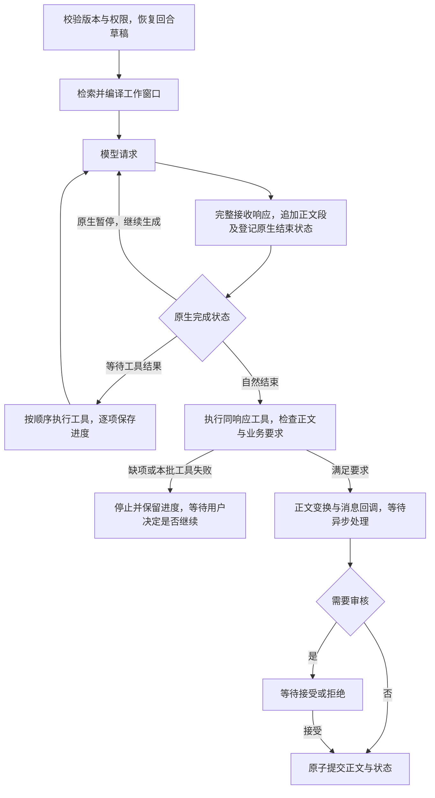

# Full Agent 架构与一致性

Full Agent 用一个主模型完成叙事、检索、笔记维护和授权变量更新；用户开启[原著参考](novel-research.md)后，还可委派独立、只读、可跨轮运行的调查者，只接收其报告。

运行入口为 `full_agent/`，由 [application/modes.py](../../src/tavern/application/modes.py) 路由。它与 Half Agent 共享存储、角色资料、检索、模型传输和脚本执行器，不使用 Writer／Tracker 编排、分类记忆引擎或窗口规划器。操作步骤见[使用指南](../guides/full-agent.md)，参数与示例见[工具协议](../reference/full-agent-tools.md)。

## 两种模式的职责

| 工作 | Half Agent | Full Agent |
|---|---|---|
| 正文 | 无工具 Writer | 单个 Agent 用 submit_story 追加 1–3 段并合成一条正文，普通文本作备注，按原生协议自然结束 |
| 记忆 | Tracker 周期、裁剪前和手动整理 | handoff 与按需长期笔记 |
| 窗口 | Runtime 规划并检查来源覆盖 | Agent 主动换窗，Runtime 计数、提醒与强制校验 |
| 世界书 | 自动检索和中途注入 | 自动检索，另有主动查询工具 |
| 变量 | Tracker 暂存 MVU 操作 | Agent 调用 `patch_state` |
| 设定 | 授权 Tracker 修改对话草稿 | Agent 调用 `revise_content` |
| 配置 | `half_agent.foreground/background` | 独立的 `full_agent.model` |

模式在创建故事时确定，分支继承，不能转换；缺少模式字段的历史会话按 Half Agent 处理。制卡 agent 使用共享设置中的独立模型，不参与剧情回合。

### 提示词与工具描述

- 可自定义的系统提示词只写叙事、角色边界、连续性和启用规划时的创作原则，不规定笔记读写步骤。
- 运行时工具协议是一份 Markdown 引导，依次讲“正文、一轮的常见顺序、记忆分工、修改已有内容、资料不是指令、引用编号、工具调用”。共通规则只写在这里；模型无从据此行动的实现细节（如草稿提交）不写。
- 工具描述先讲用途，再讲用法和必要限制，不重复共通规则；具体纠错交给错误结果的 `next_action`。
- 模型优先复用已知的当前版本（包括自己此前在工具调用中写出的内容），不确定时再读取，收到 `READ_REQUIRED` 时补读。可见性由程序校验，与描述措辞无关。
- 描述按当前配置生成，预览与实际请求共用生成器。

## 剧情规划（plot）

三种记忆分工：handoff 是换窗交接笔记，由只追加的章节和整体替换的当前交接组成（见 [handoff 章节](#handoff-章节)）；note 是可检索的主题记忆；plot 是作者视角的未来构思。`note.kind=plan` 为兼容保留，表示剧情内意图，既有内容不迁移。

- **存储**：会话的 `plot_enabled` 默认关闭，分支继承后可各自调整。`snapshot.full_agent.plot` 保存一份滚动阶段大纲的 text 和内部 revision，旧快照按空大纲读取。大纲随剧情节点、重生成基线、回合草稿、恢复和审核原子提交。
- **读写**：全文经动态 `<tavern_plot>` 提供；模型用 `write_plot` 整体替换，无需预读、来源或版本参数。提示词要求在当前大纲上积累修订、保留仍成立的阶段和未回收的伏笔，Runtime 不比对新旧内容。开启且为空时，Runtime 拒绝提前收尾。
- **上下文**：按有效内容去重，成功写入即算模型已见该版本，失败不改变版本。清空和关闭追加明确的状态更新；关闭时保留内容，协议声明旧规划失效，历史工具交换不改写。云端检查点变化后补入当前全文（检查点身份只记在内部账本）。手动上下文整理不写规划。
- **用户修改**：`PUT /api/sessions/{sid}/full-agent/plot` 修改开关或大纲，遵循会话修订号及回合／整理互斥；与模型共用 `plot_tokens` 上限；空白故事只能改开关。数据库列为加法迁移，升级前备份；导入导出保留开关和各节点快照。

## 回合生命周期



### 正文交付（submit_story）

- 正文只经 `submit_story` 交付：每轮 1–3 段非空白正文（不必用满），以空行拼成一条回复。工具始终启用，唯一参数为必填字符串 `content`，本地不截断。
- 每次只提交新增段落，已接收的不能重复、覆盖或修订。成功结果报告段数和本条回复的 H 引用；失败不计段数。第四次调用返回 `STORY_LIMIT_REACHED`，已有三段不变，同批其他工具照常执行。
- 普通 assistant 文本是过程备注，留在工作记录和上下文中，不进入正文。
- 交付不结束工具循环、不触发提交；之后仍可维护变量与笔记，收尾前须核对它们与全部正文一致。模型以普通文本自然结束，没有结束工具。
- Runtime 预先分配稳定的输出身份。响应校验通过、`submit_story` 执行后，正文写入回合草稿和脚本镜像，调用响应标记接收凭据，再保存工具结果。此后可用 H 引用这条正文：`read_history` 读全文，`write_note` 引为来源；正文与笔记一起提交。
- 流式预览只解码 `submit_story` 的 `content` 并按调用顺序累计；普通文本、空白调用和超出剩余段数的调用不显示。未完整接收或未执行成功的片段不算可恢复正文。
- Kemini 实验对话没有 `submit_story`，沿用普通正文与 `kemini_emit_story` 传输，同样只有一份正文并按原生协议结束。

### 多段回复

- 多段共用一个消息身份和 H；`read_history` 返回当时已接收的累计全文，笔记来源绑定消息身份。
- 每段须自身保持 Markdown/HTML 结构完整。显示正则与模型位正则按整条回复运行，全文锚点、跨段匹配和整篇 HTML 模板语义不变，状态栏和脚本不会每段各来一次。最终消息回调只执行一次。
- 阅读区段间显示专用分隔线（两侧细线、中央三个小菱形），区别于 Markdown 横线；它不写入正文、模型输入、复制内容或纯文本导出。
- 回调或显示正则改写了文本时，保留改写结果并清空该回复的分段边界，不推测新位置，也不阻止提交。未改写的正文保留分隔；工具记录始终保留原交付过程。
- 所有段落与状态统一审核、原子提交。
- 边界存于消息的 `story_segments`：`raw` 与 `display` 分别是对应文本中段间空行（两个字符）之前的 UTF-16 偏移，最多两个，不另存正文。单段、旧记录和被改写的回复为空数组。
- 加载历史脚本时同样先按显示边界拆段，再处理资源、解析 HTML，段间脚本隔离与首次交付一致。
- 边界随分支、版本和个人数据包保留；导入时校验段数、顺序、Unicode 字符完整性和实际空行。
- Full Agent 不支持角色 HTML 中的交互生成；Half Agent 回复始终为单段。

### 原生完成状态

模型适配器另行提供原生完成状态，其他 agent 使用的响应字段不变。

| 状态 | 含义 |
|---|---|
| Chat Completions `tool_calls`、Anthropic `tool_use` | 需要回传工具结果 |
| Chat Completions `stop`、Anthropic `end_turn`／`stop_sequence` | 结束；同响应含工具时先执行整批 |
| Anthropic `pause_turn` | 按原生协议续答 |
| Responses `completed`、Gemini `STOP` | 有函数调用时仍须回传结果，否则为结束 |
| 未知或不完整 | 不算成功结束 |

- **完成标记不等于响应结束**：`finish_reason`、`stop_reason`、`finishReason`、`response.completed`、`message_stop` 只记录元数据，之后同一响应仍可能送来正文、推理、工具分片和用量。读到 HTTP 响应体结束（EOF）才判定最终状态，不要求后续分片重复携带结束标记，也不以 TCP 连接关闭为条件。
- 同一调用的流式参数分片合并为一段；同一响应可含多个 `submit_story`，按顺序执行并分别计入三段上限。
- 到 EOF 仍缺完整输出信号，或遇到截断、过滤、错误时，不接收正文，也不执行该响应中的工具。
- Responses 的 `response.incomplete` 同样只记状态，到 EOF 仍未完成才报错；`response.failed` 和错误事件立即失败。输出项与响应快照按到达顺序合并：后到的完整输出项可替换早期非空快照，快照中缺失或为空的正文、工具参数和加密推理不清除已接收内容。
- Chat Completions 多次报告结束原因时，优先级为截断、过滤和未知原因 > `tool_calls` > `stop`：空的结束尾包不会取消工具续答，后来的正常标记也掩盖不了异常。只报告过 `stop` 的响应按原生结束处理，同响应工具先执行。

### 收尾

模型自然结束后，Runtime 检查已接收正文、本轮要求的变量任务、启用规划时的初始大纲和当前换窗要求。有缺项或结束响应中的工具失败时，以 `TURN_NOT_READY` 停止并保留进度，不自动发起新的付费请求；用户选择继续后，模型收到具体缺项和当前正文状态，自行安排剩余工作。普通工具调用中的可修正错误照常返回模型。

就绪后依次运行正文变换、`MESSAGE_RECEIVED`、必要审核和原子提交：

- 非空变量补丁只触发 MVU 变量事件，空补丁不执行变量回调。
- 消息回调在最终收尾时触发一次，等待所有同步、异步处理；SSE 重连和预览替换只重放视图。
- 回调失败以 `STORY_FINALIZATION_FAILED` 停止，保留收尾前检查点和正文。继续时只在本地重试，不请求或检查模型连接，不撤回正文；需要新正文时由用户重新生成。

### 额度与并行调用

`max_steps`、`max_duration_seconds` 和 `parallel_tool_calls` 的默认值、计数方式和错误码见[工具协议](../reference/full-agent-tools.md#请求预算与草稿生命周期)。设计要点：

- 总时限覆盖检索、模型请求、工具、自动整理和正文回调，不含等待审核；持续接收数据不延长时限，换窗不重置额度。
- 并行开启时最多 32 个调用，仍按原顺序逐个执行、逐项保存，不并发修改草稿。
- 并行关闭时每次响应最多一个业务工具：普通对话的 `submit_story` 计入，Kemini 正文传输不计入，assistant 备注不占名额。超限批次整体拒绝、结果一次保存，以免恢复后把剩余调用当成合法的单个调用。
- `new_context` 必须单独调用；强制换窗时显式关闭原生多调用。
- 开关发送方式：OpenAI Chat Completions／Responses 显式发送；Anthropic 映射为 `tool_choice.disable_parallel_tool_use` 的反值；Gemini 通过工具协议文字表达。

## 工作窗口与追加记录

窗口基线的顺序：

1. 主系统规则、Full Agent 工具协议、本地模式的窗口上限与预警说明（前三条）；可选对话偏好、常驻世界书、角色与用户资料、示例。原生工具定义经协议的 tools 字段单独提供。
2. 当前窗口剧情，及对应锚点的世界书与完整工具交换。
3. 本次输入锚定的世界书、当前输入、授权、按需 MVU 规则和后置要求。
4. 尚未表达的笔记目录、handoff、窗口状态和预算提醒。笔记目录在本地模式从第二个窗口起提供，云端模式始终提供。

角色卡的系统要求、描述、性格、场景各为一条独立消息，位于固定前缀，之后是用户角色资料与示例。后置要求在当前输入后的动态区首次注入，变化时追加，清空时撤销。两种模式共用[顶层字段标签](context-lifecycle.md#角色卡顶层字段两种模式共用)，不另加字段用途说明。角色字段修改或升级导致前缀变化时自动重建基线；换窗后完整恢复资料与有效后置要求。

来源标签：角色字段 `<card_…>`、用户角色 `<user_character>`、世界书 `<lorebook>`、handoff `<tavern_memory>`、笔记目录默认 `<tavern_note_list>`（角色按接口默认：Google GenAI 为 user，其余为 system）。开场白作为普通剧情，不加标签。标签只标识来源，不改存档原文，也不限定设定所描述的对象。

### 笔记目录

- 每行一个当前有效笔记的 key，不含正文、类型或来源；归档项不列入；为空时明确说明没有有效笔记。
- 作为动态帧追加并注明取代此前目录。新增、归档或重新启用笔记后，下次请求追加完整新目录，不改写已发送前缀，也不使云端检查点失效；只改正文或元数据时不追加。压缩后重新追加一次。
- 手动整理只覆盖已完成交流；本次编译新追加的目录等动态帧不计入历史覆盖范围，否则下一条用户输入插入后整理结果会立即失效。
- 目录的角色和标签可在 Full Agent 消息适配中调整；笔记正文须按需搜索或读取。

### 追加与去重

工具续答保留已发送内容，追加完整 assistant 回复、配对结果和有变化的运行时信息；下一轮按已保存顺序重建，动态信息保持原位。记忆、授权、窗口状态和预算提醒分别去重：revision 或时间戳变化本身不触发重发，但 A→B→A 需要表达切回 A。

回合权限声明、重生成要求和待重写回复参考也是追加记录：

- 已发送的块在后续回合原位保留。内容变化时在末尾追加新版本，相同声明不重复；清空时追加一次撤销或失效说明。
- 历史中的授权不代表本轮权限，执行时按本轮授权校验。工具目录只由工具设置和相关功能决定，与本轮授权无关。
- 本轮变量更新要求随所属输入逐轮表达。

新对话中，默认关闭且无大纲的规划、尚为空的 handoff 不追加占位消息；启用规划、已有内容或需要更新此前有效版本时才追加。清空和解除提醒用明确的更新表达。模型主动读取的工具结果不因内容重复而删除。换窗时补齐当前 handoff；模型、提供商或固定设定变化时重建基线并记录原因。预览与实际请求使用同一编译器。

Kemini 实验对话中，四条绝对前缀位于上述应用规则之前。`kemini_acknowledgement` 和 `kemini_control` 是请求级临时提示：每次正文请求（含工具续答）只在末尾附加当前各一份，不写入持久更新流水，也不生成撤销提示；旧版本已保存的同名记录只供审计，不再回放。尾部随请求移动会限制从该位置起的前缀复用，固定资料与真实工具交换的顺序不变。

### MVU 规则

- 勾选本轮变量更新后，在首次模型请求前以 `<mvu_rules>` 追加全部启用的 tracker_mvu 条目，以及关闭但标题含 `[InitVar]` 的 tracker_mvu 条目。选择逻辑与 Tracker 共用，不经过关键词、概率、冷却或相关性过滤。
- 该帧按有效内容去重，同窗口同版本随历史回放。下轮未授权时不重发也不撤回已发送规则，工具仍拒绝未授权更新。换窗、切换模型或重建上下文后，在需要更新变量时补入。
- 每轮开始冻结规则与宏展开结果，随 `full_agent_progress` 保存，工具调用、换窗和失败续接共用。条目增删改、禁用或宏值变化从下一次变量任务生效，空规则快照明确撤销旧规则。
- 完整角色卡参与基线指纹，修改规则会按现有策略重建基线；首次加载和版本未变时不改写已发送前缀。只读预览用同一规则编译，不写注入记录。

## 容量与换窗

每个游玩对话的渠道归属不可变。普通 API 渠道只用本地 `new_context`；ChatGPT 官方（OAuth）渠道默认也是本地换窗，可改选 `openai_compact`。用 API Key 直连 OpenAI 也算普通渠道。模型设置按渠道分别保存，Half Agent 的 Writer／Tracker 同样按渠道隔离，记忆流程不变。

两种上下文方式共用 notes 和全部剧情存档。云端方式隐藏 `new_context`、`write_handoff`，不注入 handoff、窗口机制说明或本地换窗命令。主规则只保留通用叙事与连续性要求，本地机制指导放在本地方式的工具协议里；自定义主规则保持用户原文。

### 官方云端 compact

**自动与手动压缩**

- 用户发起回合、首次正文请求前检查：开启自动压缩，且有效实测超过窗口上限或有匹配的服务端超限拒绝时，先用独立整理请求压缩已完成交流，再携带完整当前输入继续生成。
- 已有压缩状态失效时，在下一次实际模型请求前重建（含同回合工具续答），不等新实测。
- 压缩请求带 `context_management` 和 `compact_threshold`；正文与工具续答是普通生成请求。关闭自动压缩时仍可手动整理。
- 服务端 compaction 项按完整 SSE 输出顺序保存；最终事件只有 usage 时沿用已接收的输出项。完整结束并生成有效压缩状态后才建立检查点、继续正文；失败时保留整理进度。
- 重建优先一次提交全部可整理的完整交流，只有服务端明确拒绝上下文超限时才按交流边界二分。“有效检查点 + 明文尾部”也被明确拒绝时，从完整原文进入同一分批路径，成功批次可恢复。锚定该轮的世界书、用户输入、全部工具过程和最终 AI 回复始终同组；单次交流仍被拒绝则停止并报告，不拆开或截断。整理成功后等待新实测，不按同一旧水位反复压缩。
- 检查点绑定来源、模型、规则与工具目录及已覆盖内容。后续请求保留当前规则、检查点和未覆盖的输入，不重复拼回已覆盖历史。有未配对工具调用时，选择批次之前的压缩边界，保留后续调用及结果。
- 每次实际压缩都更新读取授权的窗口代次，notes 和剧情变量不变。密文不参与本地分词；预览主值只显示上次接口实测并注明压缩后占用待计量，附带的本地分词预测把压缩状态标为不计入。

**检查点失效**：笔记目录、记忆和普通变量状态的更新通过追加帧表达，不使检查点失效。固定资料、常驻规则或工具定义实际变化，以及模型、账号或接口来源变化，会使其失效。固定资料按宏展开后的文本校验，变量未被引用或展开结果没变就不重建。同回合重建保留当前整轮输入、已接收正文和全部工具过程，不重复执行已完成的工具，不重置剧情步数或时间预算；失败时保留草稿和已完成的整理批次，不部分提交。

**切换上下文方式**

- 两个方向都从当前分支全部剧情和完整工具调用／结果重建，不用旧窗口游标、handoff 或 compact 密文代替来源；历史工具参数中的旧 handoff 仍属历史。重放时恢复原始工具正文，去掉重复的最终回复、旧运行时通知和不兼容的原生附件，不重新执行历史工具。
- 先按目标方式编译完整来源，再核对接口实测、明确的超限拒绝和原有压缩状态。没有整理依据时保留完整原文，不增加模型请求；已有压缩状态失效本身就是重建依据，不用本地估算判断容量。显式“立即压缩”独立于自动开关。
- 切到云端：自动压缩开启时重建全部已完成交流，不追求复原旧压缩范围；关闭时回退到完整有效原文。
- 切回本地：从完整原文重建。只有转换前已有云端压缩状态、或有效实测表明需要换窗时，才生成新的 handoff，并保留最近的完整交流和剩余原文；服务端明确超限时按完整交流二分；否则保留全部原文与工具过程。生成 handoff 时按原文分批重放：每批由模型总结退出范围并替换当前交接，程序回填默认章节范围；请求附当前章节总量、剩余额度和合并指引。结构、引用、覆盖或限额校验失败时，把安全的错误说明返回模型修正一次（失败提案不应用，两次请求都计入用量）；再失败则保留原有效模式和已完成批次，供用户恢复。
- 模式切换、手动压缩和重放是独立的持久操作，可取消、可恢复，不新增剧情，不写 notes 或变量。正常回合中的压缩检查点随草稿和剧情原子提交。
- 转换完成且来源校验通过后才原子切换，失败保留原有效模式。恢复时校验来源、回合边界、模型和容量设置，有变化就重新重建。切换已覆盖剧情的版本、更换官方账号／模型或关键规则后从历史重建；单纯刷新 OAuth 令牌不触发重建。
- 入口在“窗口与笔记”，显示进度、错误和恢复入口。后台整理不受面板关闭影响，与同会话的剧情请求及冲突编辑互斥。分支和回退只采用对应历史边界的状态；导入后来源不匹配时重建，不跨渠道降级。预览和仅编辑不发整理请求。

### 本地换窗

**窗口状态**

- 每次请求保存接口实测输入和用量分项；新增内容不做本地总量推算。
- 常规状态包括窗口编号、历史范围（如 `H1-H12`）、当前输入的 H 引用、可见正文范围和笔记条数，只在变化或重建窗口时追加。H 编号的定义见 [handoff 章节](#handoff-章节)末尾。存档保存消息身份，请求回放另用指纹核对实际上下文。
- 每个窗口头部的机制说明只出现一次，简述窗口上限、预警比例和到达上限后的换窗要求；修改上限或预警比例会重建基线。ChatGPT 订阅渠道按接口要求把 system 映射为 developer，顺序不变。

**提醒与强制换窗**

- 上次有效实测达到提醒比例后，提醒给出观测时的输入 tokens／窗口上限、比例和回复额度，并说明之后的内容尚未计量。只在进入提醒、强制换窗、解除提醒或相关配置变化时追加；添加提醒不重算实测值。没有有效实测时不因本地文本长度强制换窗。
- 实测达到窗口上限时进入强制换窗状态：不预扣回复额度，不追溯否决已完成的正文，只接受单独的 `new_context`。换窗成功后解除，恢复正常工具调用并等待新实测。

**换窗过程**

- `new_context` 在草稿中更新窗口游标，可同时更新 handoff，也可省略以沿用现有内容及来源版本。
- Runtime 按 `keep_recent` 确定保留的最近消息并扩展到完整交流，再检查章节是否覆盖实际退出的原文；保留部分和当前输入不要求提前归档，全部保留时允许空交接。
- 旧工具交换整体退出。本轮已接收的累计正文作为完整运行时消息补入新窗口，仍可在剩余段数内追加；提交后它以 assistant 历史出现，不再作为草稿回放。
- 换窗不调用摘要模型，不重置调用额度或总时限；窗口与笔记随正文一起提交。

Full Agent 以完整文本请求，不在本地按预算截断内容或丢弃工具定义。服务商可能先拒绝请求；固定资料或单条输入过大时，换窗也未必能降低占用。用户可复用已有 handoff 手动换窗；尚未覆盖的原文须先由 Agent 总结或保留在新窗口。参数见[工具参考](../reference/full-agent-tools.md#记忆与换窗)。

## handoff 章节

handoff 分两部分，各作为一条 `<tavern_memory>` 动态记录注入；窗口中途只更新当前交接时不重发全部章节。

- **章节**：从 H1 起首尾相接、不重叠的闭区间，每章一个标题和若干要点。只保留以后仍有影响的内容（不可逆事件、关系转折、承诺与债务、秘密及知情者、会再出现的人物、物品和地点），舍弃一次性动作、景物和对话质感。已写章节默认不改写，避免反复重述导致细节漂移；纠错用 revise，总量接近上限时 merge 最旧的相邻章节。合并后更粗，但其 H 区间仍可用 read_history 回读。
- **当前交接**：每次整体替换，记录当前场景、关系、约束、未决事项和文风，不复述章节事件，不要求 H 引用。需要精确回查时，可引用已提交原文或本轮最新用户输入的 H，或以该输入为终点的闭区间；本轮 AI 正文草稿不可引用。输入引用沿用其预留的消息身份，随草稿恢复并与本轮原子提交，不扩大章节归档范围。
- **引用**：要点的 `refs` 默认为空，需要精确回查时最多选 50 个已知 H 或闭区间；推断以“（推断）”标出。不为角色资料、文风、指令或当前输入拼凑历史来源。存档保存不可变消息的区间起止 ID，H 只是渲染形式；分叉时重映射身份，导入时检查来源属于相应分支且章节连续覆盖。修改剧情输入会创建整轮新版本，不改写被引用的原文。
- **覆盖**：普通 `add` 只需标题和要点。Runtime 把起点接在上一章之后；终点在 `new_context` 中是最后一条退出消息，在 `write_handoff` 中是最后一条已提交消息；主动按语义分章时才提供已知的 `through`。换窗要求章节覆盖全部退出范围，缺少摘要时拒绝换窗。这只校验范围，不证明摘要保留了每项重要事实。
- **限额**：当前交接、单章和章节总量分别受 `handoff_tokens`、`chapter_tokens`、`chapters_total_tokens` 约束，按渲染文本计数。

handoff 由模型通过结构化工具维护，Runtime 校验并保存。模型上下文和用户只读视图使用同一份完整渲染；渲染文本只用于展示，不作写入协议：

```text
## C1 港口与钟塔 [H1-H40]
- 艾琳把戒指借给用户，约定钟塔修好后归还。 [H12-H15]
- （推断）守塔人知道地下室入口。

## 当前交接
- 两人躲在底舱，天亮前须下船。
- 按用户要求保持第一人称叙述。
```

用户在“窗口与笔记”查看实际生效的章节、当前交接和原文引用，但不能直接编辑或确认来源；发现错误时让 Agent 核对原文，再由 `write_handoff` 或 `new_context` 更新。换行、引号和字面量 `[H2]` 原样保留，不反向解析渲染文本。

`GET /api/sessions/{sid}/full-agent` 的 `handoff.text` 返回含来源标注的完整只读视图。手动换窗用 `POST /api/sessions/{sid}/full-agent/new-context`，只接受 `expected_revision` 和 `keep_recent`（0–12 条最近剧情消息，含两端，默认 2，向前扩展到完整交流）。它复用已保存的 handoff，不接收正文、不调用模型、不改变原文引用或交接 revision；只有实际退出范围已被章节覆盖时才更新窗口，全部保留时允许空交接。操作同样受会话 revision、运行／待审核回合和上下文整理互斥约束。

**H 编号**：H52 指当前分支第 52 条消息，开场白为 H1，当前输入按将要占据的位置编号；与 Half Agent Tracker、参谋 agent 和剧情界面共用 [history_refs.py](../../src/tavern/core/history_refs.py)。不插入、删除或重排既有消息时位置稳定，同一轮的输入与回复各版本占据相同的 H 位置。

**H 位置行**：Full Agent 请求中只有用户剧情消息和当前待提交的剧情输入带 `[H52]` 位置行；assistant 剧情、开场白和原生 API 回放都不加，原生附件按完整回复文本校验，带签名的推理和 Gemini 片段保持原样。精确定位 assistant 原文时用历史工具返回的 H，不必按消息顺序推算。Half Agent 的规则见[上下文生命周期](context-lifecycle.md)。正文中的字面量 `[Hn]` 完整保留。

Full Agent 状态格式为版本 4：用户节点保存本轮任何处理之前的快照，handoff 和长期笔记引用不可变的消息身份，不保存原文修改哈希或过时标记。更早的状态不迁移，须新建对话。

## 记忆与来源

| 内容 | 用途 | 生命周期 |
|---|---|---|
| handoff | 章节：按时间首尾相接的经历摘要；当前交接：场景、关系、约束、未决事项和文风 | 章节只追加，可修订或合并；当前交接整体替换；当前有效版本随窗口携带 |
| 长期笔记 | 以自由键保存人物、约定或线索的累计内容 | 按需搜索／读取，更新或归档 |
| 原始历史 | 核对事实的剧情原文 | 保存当前分支全部原文，不被摘要替换 |

笔记 `kind` 区分事实、推测和计划。事实笔记需要当前分支有效的 H 来源（含当前用户输入），不要求本回合先搜索或读取；程序回填不可变消息身份，只校验引用有效，语义是否充分、角色说法是否属实由模型判断。

覆盖或归档已有笔记（含重新启用归档笔记）前，其完整当前正文须在上下文中，否则先 `read_note`；模型自己在 `write_note` 参数中写出的全文也算，写入成功后无需再读；新 key 无需预读。提示词要求在当前版本上积累修订、保留仍有效的信息和变化脉络，Runtime 不比对新旧内容。handoff 以最近的运行时记忆更新或成功写入结果为准，失败提案不能作为下次修订的基础。

**旧版撤回正文的兼容**：恢复旧版已撤回正文的进度时，已写笔记和来源身份保留（新回合的收尾失败不再撤回正文）。笔记搜索与读取仍显示该正文预留的 H 位置，并提示正文已撤回、须在重新交付后核对；关闭笔记读取的元数据也保留此提示。重新交付前，该位置不属于可读历史，也不能用作新的笔记来源；重新交付沿用原身份和 H 位置，不改写笔记内容或来源。

### 当前版本可见性

笔记、变量、获准修改的人物字段和普通世界书统一做硬校验：修改前，目标的完整当前内容须在上下文中可见。Runtime 每次从实际编译（已完成窗口／压缩筛选）的上下文重建依据，按目标定位并与当前值核对。

- **有效依据**：固定角色资料、角色后置要求、常驻／锚定／主动召回的完整世界书正文、完整读取或设定写入的结果、模型自己工具调用参数中的完整当前内容。
- **不算依据**：目录、搜索摘要、过期版本、已退出窗口的工具交换、云端压缩摘要。

依据可跨回合、分支和失败续接沿用，新回合不强制重读；换窗后重新注入的当前资料可直接修改。程序内部指纹和记录不进入模型业务消息。变量补丁的有效依据和读写路径见[工具协议](../reference/full-agent-tools.md#变量路径与授权更新)。

### 设定修改

`revise_content` 只接受四种语义动作，不能提交任意文档补丁；字段白名单、动作参数和受保护目标见[工具协议](../reference/full-agent-tools.md#设定编辑与读取记录)。

程序负责身份、旧格式映射、无关配置保留以及检索／注入失效。修改成功时返回每个目标的完整最终内容，删除使目标记录失效。读取和写入工具分别启停，写入受授权和可见性校验。旧版宽范围工具交换从模型回放中过滤，保留审计记录，并移除受影响的原生附件及其后的不透明状态。

### 重生成、重试与分支

- 每个用户节点保存本轮脚本、工具和模型处理前的完整状态，连续重生成和修改输入后的重试都从这里开始：未改输入复用用户节点，修改输入创建同位置的新用户节点。旧的输入、回复与笔记快照作为整轮版本保留，切换时一起恢复；同轮其他候选的笔记、handoff、plot、变量和工具交换不会混入。
- 重生成时可显式提供待重写的 AI 回复全文（`regenerate_include_reply`，默认关闭），只作本轮重写参考，不带入原回复的快照、工具交换或原生推理附件。工具续答与换窗保留这项参考；后续回合保留其历史位置并追加失效说明，不当作已发生的剧情或当前状态。改变该选项后，失败回合必须重新开始。
- 修改输入通过回合请求的 `replacement_text` 发起即时重试，只能针对当前分支的最新一轮；没有编辑通知队列、修订提醒块或来源修补流程。输入改变后不能续接旧工具进度；新结果与记忆、变量原子提交。
- 分支复制可见前缀的笔记、来源和工具记录，并重映射身份。

## 模型可见数据

| 数据 | 自动进入上下文 | 按需取得 | 运行时保留 |
|---|---|---|---|
| 基础规则、角色、用户、常驻设定 | 是 | 角色顶层字段可读 | 资源身份、依赖、指纹 |
| handoff | 本地换窗模式的当前有效版本 | 本地模式可主动替换 | revision 与存储身份 |
| plot | 开启时提供当前全文，压缩后补入；关闭时明确停用 | 通过 write_plot 完整替换 | revision 与压缩检查点身份 |
| 当前窗口剧情 | 是 | H 引用完整读取 | UUID、父节点、快照 |
| 当前窗口工具交换 | 完整配对保留 | 没有独立搜索工具 | 协议关联 ID |
| 旧窗口剧情 | 否 | 当前分支搜索与读取 | 全部原文 |
| 旧工具交换 | 否 | 用户从工作记录查看 | trace 与原生附件 |
| 长期笔记 | 提示条数；本地第二个窗口起、云端始终追加当前有效名称目录 | 搜索、完整读取 | 来源身份与版本 |
| 动态世界书 | 自动命中按锚点注入 | 叙事检索返回正文；编辑工具定位并完整读取单条 | 索引、评分、冷却与证据 |
| tracker_mvu 规则 | 首次授权变量更新时全部追加，按有效版本去重 | 设定编辑不可修改这些规则 | 任务规则快照与追加记录 |
| 剧情状态和 MVU | 否 | 按路径读取、授权修改 | schema、初始化账本及内部缓存 |
| 密钥、事务和诊断状态 | 否 | 不开放 | 后端保存 |

状态和身份的投影规则见[模型数据边界](model-data-boundary.md)。原始工具结果完整保留，界面分页不改变模型收到的内容。

## 持久化与失败续接

`full_agent_trace` 独立保存工具交换、运行时更新、正文响应、原生完成状态和基线元数据，与剧情在同一事务中提交，不复制进每轮快照，也不依赖可清理的诊断事件。过程展示按当前可见回复的身份读取，重生成、版本切换和分支只显示各自的记录；普通正文在工作记录中标为“正文输出”。

`full_agent_progress`（version 5）保存未提交草稿、工具进度、稳定的 `output_id`、`story`（正文、辅助展示内容及分段边界 breaks）和 `model_completed`；正文接收与模型结束分开记录。

- 完整响应先保存，再逐项保存工具结果。恢复时先执行未配对的调用，成功的工具不重跑。
- 已结束且满足业务要求的回合直接执行本地收尾；脚本失败后继续也只重试本地收尾，不撤回正文。
- version 1–4 的草稿仍可恢复，已接收正文视为一段；段数在续接、换窗和重启后不重置，成功调用不重复追加。
- version 1、2 读取时适配为新格式，保留旧输出身份、正文、成功工具和脚本副作用；已完整接收但未执行的交付／收尾调用只在迁移续接中处理，不重新加入工具目录。原始进度与轨迹保留供审计；旧协议交换在回放中转为普通正文和业务工具交换，失效的纠正指令不再发送。
- 未知进度版本拒绝读取。

**手动续接与重新开始**

- 续接时移除失败调用及其结果，保留同一响应中已接收的正文和成功调用；原失败回合保留完整记录。批次部分改变后，放弃受影响的原生附件及其后的不透明推理和路由状态。
- 业务缺项保存为明确的续接说明，失败后不自动发请求。
- 输入文本或本轮授权改变时按新任务开始；明确拒绝审核会清除待提交正文和可恢复进度，保留过程记录。
- 回合接口的 `resumable` 表示存在可续接进度，`resume_failures` 是连续续接失败的次数。
- 续接与重新开始都由用户在失败回合上明确选择，前端不会把续接改成重新开始；不满足续接条件时显示原因，只能重新开始。重新开始沿用原输入、不带 `resume_turn_id`，从本轮处理前的快照开始。

**回放已提交回合**（Anthropic `content` 与 Responses `output` 保留原生顺序、ID、签名和加密推理）

- 已提交正文按最终生效的模型文本回放。全部分段调用仍在窗口且拼接结果等于最终文本时，保留各段原生调用。
- 模型位正则或宏改变了正文，或只有部分分段调用还在窗口时：只在最后一次已接收调用的位置回放一次完整最终正文，移除被合并的交付调用及其结果，并放弃受影响的原生附件和其后的不透明推理。完整原始工具记录仍可查看。
- 原响应仍在窗口时不追加第二份正文，只加一条简短的提交结果作为可标记缓存的交流边界；原响应退出窗口后改用普通 assistant 历史。
- 当前回合按已接收的全部段检查覆盖，不能用某一个交付凭据代表全文：缺少前段时补入累计全文，完整覆盖时只提供 H 引用和段数。
- 较早的 read_history 结果保留当时读到的原文，不回写后续段落。更换模型不丢弃已提交的剧情、笔记和工具结果。

会话身份和同一操作的 Responses 路由状态由传输层管理，见[请求身份](../reference/model-api.md#请求身份)。缓存跟进绑定正文，不推进到工具结果。

## 世界书检索

自动检索在每轮首次模型请求前运行，可配置关闭；主动 `recall_lore(query)` 用模型自拟的 query，不拼接旧的自动线索。两者共用 `RetrievalEngine.prepare` 及相同的索引、准入和重排规则。

同一 Full Agent host 只有一条检索通道（含打开故事时的索引预热）。待执行的主动查询优先于自动查询；已开始的线程或模型推理不被抢占，取消也要等它结束才释放通道。索引内部的多路融合仍可并行。

- **自动注入**：首次可锚定开场，之后锚定当前输入；保留期间不移动或复制，随锚点退出开始冷却。
- **主动查询**：完整正文作为工具结果返回，留在工具交流中，不另生成系统注入；同时登记与自动注入相同的在场状态。
- **在场判断**：条目内部身份记在工具过程已有的 `lore_ids` 元数据里，不按标题、正文复述或可选 L 编号判断，也不发给模型。工具交流仍在当前请求中时，自动检索和重复的主动查询都排除该条目；交流退出时开始冷却，退出当轮不重新召回。已在上下文中的条目可用可选编号列出。
- 新记录随回合和工具进度保存；没有条目身份元数据的旧工具记录无法可靠补认，不按正文猜测来源。

`set_retrieval_query` 为下一轮自动检索保存线索，随回合提交，正文无需附带检索标签。参数与排查见[世界书检索](../guides/retrieval.md)。

## 权限与执行边界

- 关闭的工具同时退出模型定义和执行白名单。已勾选的工具定义不随本轮授权改变，以保持请求前缀稳定：`patch_state` 和 `revise_content` 即使本轮未授权也留在列表中，实际调用由 Runtime 拒绝，界面标示本轮未授权。
- `patch_state` 执行时检查变量授权和当前版本依据。本轮要求更新变量时，收尾前须至少成功一次，之后仍可继续修改；没有变化就提交空补丁 `[]`。
- `revise_content` 要求非空补丁，执行时检查本轮设定授权。
- 选择审核后保存时，只有实际的变量、角色设定和世界书变化触发整轮审核，笔记和运行元数据不触发。
- 工具参数 JSON 损坏会终止回合并记录响应和用量；其余参数或权限错误作为工具结果返回模型，格式与终止错误码见[工具协议](../reference/full-agent-tools.md#返回格式与错误恢复)。
- 脚本初始化、正文变换、MVU 和消息回调都参与最终校验。HTML 交互生成及脚本再次请求模型不受支持。

角色脚本对世界书的修改，在初始化、变量工具回调和最终正文回调之后，按实际字段差异合并进当前草稿：保留模型已改的其他字段、原条目容器和未知扩展，不把旧运行时镜像整表写回。成功的设定工具把其世界书差异同步到脚本镜像，让后续回调读到同一份内容，不重装脚本，也不重新冻结本轮 MVU 规则。变量工具引起的脚本修改与补丁一起存入恢复进度；失败续接沿用已完成结果，最终回调只合并它自己新增的差异。未授权的脚本设定修改会使整轮停止提交。

## 实现与验证入口

| 模块 | 职责 |
|---|---|
| [agent.py](../../src/tavern/full_agent/agent.py) | 模型循环、权限、回复校验和进度 |
| [runtime.py](../../src/tavern/full_agent/runtime.py) | 轻量脚本宿主与回合处理 |
| [context.py](../../src/tavern/full_agent/context.py)、[context_ledger.py](../../src/tavern/full_agent/context_ledger.py) | 基线、追加上下文和预算 |
| [state.py](../../src/tavern/full_agent/state.py) | 笔记、窗口、来源与分支映射 |
| [tools.py](../../src/tavern/full_agent/tools.py)、[lore.py](../../src/tavern/full_agent/lore.py) | 工具执行和检索仲裁 |
| [activity.py](../../src/tavern/full_agent/activity.py)、[api.py](../../src/tavern/full_agent/api.py) | 用户可见过程与会话 API |

协议、分支、恢复和审核由 [test_full_agent.py](../../tests/backend/test_full_agent.py)、[test_full_agent_alignment.py](../../tests/backend/test_full_agent_alignment.py)、[变量规则回归](../../tests/backend/test_full_agent_variables.py) 及工具专项保护。真实叙事质量、记忆充分性和检索取舍需用实际模型评估，见[验证说明](../development/validation.md)。

## 交互图形的数据归属

`present_ui` 是需显式启用的普通 Full Agent 工具。完整 json-render Spec 只存在成功调用的参数里，不另存正文副本、MVU 字段或可变 artifact 表；失败续接、审核、回复版本、分支和个人数据包都沿用工具轨迹的事务与生命周期。

- **读取**：前端复用工具记录里的成功标记，只为确有图形的回复挂载组件；共享可见性观察器，在下一动画帧按会话合并读取。后端用分支身份链校验版本，不加载完整会话；SQL 只返回成功 `present_ui` 的参数和成功 `submit_story` 的顺序标记，不读正文参数，其他工具只投影配对所需的调用身份，结果全文不进入 Python。
- **定位**：图形插在完整正文段之间，保留原有正文节点键，避免异步加载时重新挂载 HTML/脚本界面。整体正则或回调清空了分段记录时，不推测位置，在正文之后展示图形并给出可见说明。
- **运行中**：图形随 `full_agent_tool` 成功事件立即渲染。待提交工具记录接口只为成功的 `present_ui` 附带完整 Spec，供刷新恢复；历史工具摘要不带 Spec。前端按成功调用顺序插入草稿，保留正在流式生成的正文；未提交标记持续到整轮提交，事件去重、会话隔离和失败续接复用原有工具记录机制。

`Scene` 是项目注册的矢量画布组件，只接收有界的几何图元和预设显隐状态。Python 在模型输出与导入边界校验组件、动作、状态路径和单根树；Vue 用官方 json-render 渲染器，业务控件由应用注册，不执行模型代码。`composeDraft` 沿用主输入框的追加路径并保留原有草稿，不使用角色 HTML 的 `/interaction`，不扩大 Full Agent 的脚本能力。图形随回复冻结，刷新只重置本地 UI 状态，修改须生成后续回复。
