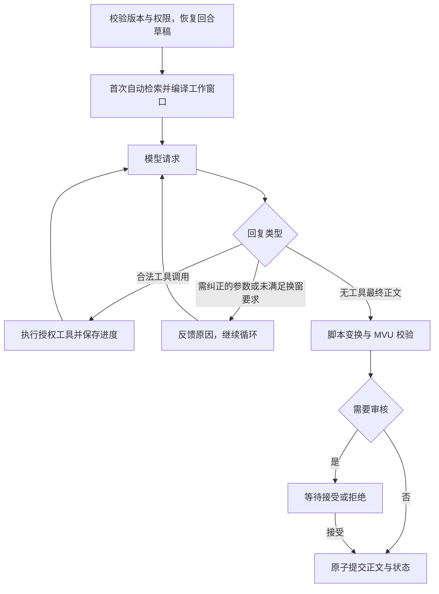

# Full Agent 架构与一致性

Full Agent 使用一个模型完成叙事、检索、笔记维护和授权变量更新。运行入口位于 `full_agent/`，由 [application/modes.py](../../src/tavern/application/modes.py) 路由。它共享存储、角色资料、检索、模型传输与脚本执行器，不使用 Half Agent 的 Writer／Tracker 编排、分类记忆引擎或窗口规划器。

本文面向修改运行时的开发者。操作步骤见[使用指南](../guides/full-agent.md)，参数及工具实例见[工具协议](../reference/full-agent-tools.md)。

## 两种模式的职责

| 工作 | Half Agent | Full Agent |
|---|---|---|
| 正文 | 无工具 Writer | 单个 Agent 的无工具最终回复 |
| 记忆 | Tracker 周期、裁剪前和手动整理 | handoff 与按需长期笔记 |
| 窗口 | Runtime 规划并检查来源覆盖 | Agent 主动换窗，Runtime 计数、提醒与强制校验 |
| 世界书 | 自动检索和中途注入 | 自动检索，另有主动查询工具 |
| 变量 | Tracker 暂存 MVU 操作 | Agent 调用 `patch_state` |
| 设定 | 授权 Tracker 修改对话草稿 | Agent 调用 `revise_content` |
| 配置 | `half_agent.foreground/background` | 独立的 `full_agent.model` |

模式在创建故事时确定，分支继承，不直接转换已有故事。缺少模式字段的历史会话按 Half Agent 解释。Card Editor 使用共享设置中的独立模型，不参与剧情回合。

可自定义系统提示词表达叙事、角色边界、连续性和启用规划时的创作原则，不规定笔记的读写步骤。运行时工具协议集中定义资料与授权边界、草稿提交、读取记录，以及 handoff／note／plot 的职责；各工具描述定义具体参数、前置条件、特例和恢复动作。已有 note 的完整当前正文不在上下文中时须先读取，新笔记无需预读。描述按当前配置生成，预览与实际请求共用生成器。

## 剧情规划（plot）

会话 `plot_enabled` 默认关闭，分支继承后可独立调整；`snapshot.full_agent.plot` 存储单份滚动阶段大纲的 text 与内部 revision，旧快照按空大纲读取。它随剧情节点、重生成基线、回合草稿、恢复及审核原子提交，不建立第二套历史。

handoff 是换窗交接摘要，note 是可检索的主题记忆，plot 是作者视角的未来构思。note.kind=plan 保留兼容，表示剧情内意图；既有内容不自动迁移。规划全文经动态 `<tavern_plot>` 提供，模型通过 `write_plot` 完整替换，无需预读、来源引用或版本参数。开启且为空时，运行时拒绝提前结束的正文；后续修订由模型判断。

上下文账本按有效内容去重，成功工具写入构成有效观察，失败不改变版本；清空与关闭有显式状态更新。云端检查点身份仅进入内部账本，检查点变化后补入当前完整规划，后续续答仍去重。关闭保留持久内容，协议明确撤销旧规划的作用，历史工具交换不被改写。手动上下文整理不写规划。

玩家用 `PUT /api/sessions/{sid}/full-agent/plot` 修改开关或大纲，遵循会话修订号和回合／整理互斥。正文与模型写入共用 plot_tokens 上限；空白故事只允许修改开关。新数据库列采用加法迁移，升级前备份，导入导出保留开关和各节点快照。

## 回合生命周期

回合调用上限涵盖所有工具续答和换窗。调用额度由运行时内部管理；禁止向模型上下文注入调用上限、剩余次数、倒计时或最后一次调用的收尾提醒，也不提供此类通知的开关、消息类型或适配设置。达到上限时停止本轮并报告 `BUDGET_EXHAUSTED`，保留可恢复进度及此前已提交状态。手动续接获得新请求额度；协议损坏或处理失败同样停止并保留进度。工具成功不代表剧情提交；最终正文、脚本变换和审核决定草稿能否生效。

只有完整结束且不含工具调用的最终回复进入剧情。带工具调用的 assistant 文字和结果属于过程记录，排在对应正文之前；provider reasoning 不作为可见剧情过程展示。

全局 `full_agent.tools.parallel_tool_calls` 默认开启，允许一次模型响应提出多个独立工具调用；后台按返回顺序执行并逐项保存进度，不并发修改草稿。OpenAI Chat Completions／Responses 显式发送 `parallel_tool_calls`，Anthropic 映射为 `tool_choice.disable_parallel_tool_use` 的反值；Gemini GenerateContent 没有对应开关，使用完整工具协议表达当前策略。关闭时，所有协议统一在执行前拒绝多调用批次并返回 `PARALLEL_TOOL_CALLS_DISABLED`，整批拒绝结果一次保存，避免恢复时把剩余调用当作合法单调用执行。此前已保存的成功调用不回滚、不重跑。强制换窗时显式关闭原生多调用，`new_context` 混合批次仍整批拒绝。

## 工作窗口与追加记录

窗口基线按以下顺序组织：

1. 主系统规则第一条、Full Agent 工具协议第二条、本地模式的窗口上限与预警机制说明第三条，然后是可选对话偏好、常驻世界书、角色与用户资料、示例；从第二个窗口起，在头部末尾追加当前有效长期笔记的完整 key 列表。原生工具定义独立通过协议的 tools 字段提供，不写入这些消息。
2. 当前窗口剧情，以及对应锚点的世界书与完整工具交换。
3. 本次输入锚定的世界书、当前输入、授权、按需 MVU 规则及后置要求。
4. 尚未表达的 handoff、窗口状态和预算提醒。

角色字段使用 `<card_…>` 标签，用户角色使用 `<user_character>`，世界书使用 `<lorebook>`，handoff 使用 `<tavern_memory>`，笔记目录默认使用 system 消息与 `<tavern_note_list>` 标签。开场白作为普通剧情，不加资料标签。标签只标识来源，不修改存档原文，也不限制设定描述的对象。

笔记目录只包含名称，每行一个 key，不包含正文、类型、来源或过时标记；归档项不列入，空目录保留空标签块。新增、归档或重新启用笔记后，下一次请求更新头部目录；仅正文或元数据变化不改动该块。目录位于固定资料之后，保持此前的请求前缀稳定；名称集合变化沿用上下文基线重建规则。角色和标签可通过 Full Agent 消息适配映射调整，正文仍须按需搜索或读取。

工具续答保留已发送内容，追加完整 assistant 回复、配对结果和发生变化的运行时信息。下一轮按已保存顺序重建，不能把动态信息全部移到末尾。记忆、授权、窗口状态和预算提醒分别去重；revision 或时间戳变化本身不触发正文重发，A→B→A 则需要表达切回 A。

清空内容和解除提醒使用明确更新。模型主动读取的工具结果不因内容重复被删除。换窗时补齐当前 handoff；模型、提供商或固定设定变化时重建基线并记录原因。预览与实际请求使用同一编译器。

勾选本轮变量更新后，在首次模型请求前以 `<mvu_rules>` 追加全部启用的 tracker_mvu 条目，选择逻辑与 Tracker 共用，不经过关键词、概率、冷却或相关性过滤。`mvu_rules` 运行时帧按有效内容去重，同窗口同版本沿历史回放；下轮未授权时不重发也不撤掉已发送规则，工具仍拒绝未授权更新。换窗、模型切换或上下文重建后，在需要更新变量时补入快照。

每轮开始冻结规则及宏展开结果，随 full_agent_progress 保存；工具调用、换窗和失败续接使用同一份。条目新增、修改、禁用、删除或宏值变化从下一次变量任务生效，空规则快照明确撤销旧规则。完整角色卡仍参与基线指纹，所以修改规则会按现有策略重建基线；首次加载和未改变版本的使用不改写已发送前缀。只读预览采用同一规则编译，不写入注入记录。

## 容量与换窗

角色卡的系统要求、描述、性格、场景以独立消息放在固定前缀，随后为用户角色资料与示例；后置要求在当前输入后的动态区首次注入、变化时追加、清空时撤销。两种模式共用[顶层字段标签](context-lifecycle.md#角色卡顶层字段两种模式共用)，不额外注入字段用途说明。普通续答保持固定前缀，角色字段修改或升级导致前缀变化时自动重建基线；换窗后完整恢复资料与有效后置要求。

每个游玩对话保存不可变的渠道归属。普通 API 渠道的 Full Agent 只使用本地 `new_context`；ChatGPT 官方（OAuth）渠道默认也使用本地换窗，但可选择 `openai_compact`。模型设置按渠道分别保存，Half Agent 的 Writer／Tracker 同样按渠道隔离，但保留原有记忆流程。API Key 即使直连 OpenAI 也属于普通渠道。

两种 Full Agent 模式共用 notes 和全部剧情存档。云端模式隐藏 `new_context`、`write_handoff`，不注入 handoff、窗口机制说明或本地换窗命令。主规则只保留通用叙事与连续性要求，内置本地机制指导移入本地模式的工具协议；自定义主规则保持用户原文。

### 官方云端 compact

自动压缩在用户发起一轮对话后、首次正文模型请求前检查一次：编译本轮输入（含当前用户输入与工具定义），本地估算长度超过设置的上下文窗口上限时，先发独立整理请求压缩已完成交流，再完整携带当前输入继续本轮。未超过上限、自动压缩关闭或本轮工具续答时不自动整理；不再使用本地换窗的 70% 提醒比例。普通正文与工具续答请求不携带自动压缩配置，只有整理请求携带 `context_management` 与 `compact_threshold`。关闭自动压缩后仍可手动压缩。服务端返回的 compaction 项按完整 SSE 输出顺序保存，不能因终止事件只含 usage 而丢失；未完整结束的响应不形成有效检查点。自动整理失败或未生成压缩状态时不继续正文。

两种上下文方式的切换都从当前分支全部剧情和完整工具调用／结果重建，不以旧窗口游标、handoff 或 compact 密文代替来源。历史工具参数中的旧 handoff 仍属于历史。重放恢复原始工具正文，去掉重复最终回复、旧运行时通知及不兼容原生附件，不重新执行历史工具。

先按目标模式编译并计算完整请求长度，包含固定提示词、工具定义、消息协议开销和已有派生状态的可见部分。原文能承载时直接使用，不请求模型；需要转换时才从头到尾重放，生成目标派生状态。compact 在超过窗口上限时转换，本地换窗在达到窗口上限时转换；不按首次发送、是否游玩或检查点是否存在做特判。正常请求使用有效派生状态加新增内容；状态失效后也先从原文按长度判断。关闭自动压缩时，普通请求不因无检查点自动整理；显式切换和立即压缩独立于该开关。

分批只能发生在完整用户／AI 交流之间：锚定该轮的世界书、用户输入、全部工具过程与最终 AI 回复保持在同一组，消息中间绝不切割。每次加入完整交流后才检查长度，允许因此超过窗口上限。服务端明确拒绝超窗时，compact 重放只能减少完整交流组数；单轮仍被拒绝则如实报告，不能拆开该轮或截断原文。短尾部原文直接保留，不额外请求模型。

压缩检查点绑定来源、模型、规则与工具目录、已覆盖内容；后续请求保留当前规则、检查点及尚未覆盖的输入，不重复拼回已覆盖历史。存在未配对工具调用时选择批次前的压缩边界，保留后续调用及结果。每次实际压缩更新读取授权的窗口代次，notes 和剧情变量不因此改变。密文不参与本地 token 分词，预览明确显示可见文本估算与加密状态占用未知。

模式切换、手动压缩和重放使用独立的持久操作，支持取消和恢复，不新增剧情、不写 notes 或变量。正常回合中的压缩检查点随草稿及剧情原子提交。切回本地模式时从完整原文逐段生成新的 handoff，并保留最近完整交流及剩余原文；不需要换窗时保留全部原文与工具过程。转换完成且来源校验通过后才原子切换；失败保留原有效模式。恢复校验来源、回合边界、模型和容量设置，变化时重新重建。修改已覆盖历史、变更官方账号／模型或关键规则后从历史重建；单纯刷新 OAuth 令牌不触发重建。

操作界面位于“窗口与笔记”，显示进度、错误和恢复入口。后台整理不受面板关闭影响；同会话的剧情请求及冲突编辑互斥。分支和回退只采用对应历史边界的状态；导入后来源不匹配时重建，不跨渠道降级。

### 本地换窗

每次请求估算消息、工具定义、结果和原生续答 reasoning 的占用。常规状态提供当前分支窗口编号、历史范围、当前输入的 H 引用、可见正文范围及笔记条数；只有这些内容变化或重建窗口时才追加，普通工具续答不重复通知。

每个窗口头部的机制说明只出现一次，简短说明窗口上限、预警比例及达到上限后的换窗要求；普通工具续答沿用这段固定前缀，修改窗口上限或预警比例则重建基线。ChatGPT 订阅渠道按接口要求将 system 映射为 developer，保持消息顺序。

达到配置的提醒比例后，预算提醒提供提醒发生时的占用百分比、当前估算 tokens / 窗口上限和回复额度。只有进入压力提醒、进入强制换窗、解除提醒或相关预算配置变化时才追加，token 估算的逐步增长不触发重发。实时占用仍由每次请求重新计算并显示在上下文预览中。旧版倒计时和逐次预算提醒在下次上下文编译时退出活动基线，剧情和工具交换继续保留。

只有当前上下文本身达到模型窗口估算上限时，才进入强制换窗状态；不预扣回复额度，也不追溯否决已经完成的正文。包含 `new_context` 的混合批次在任何状态下都于执行前整批拒绝；强制状态只接受单独的 `new_context`，正文和其他工具也被拒绝并反馈原因。成功换窗后重新检查新窗口，再恢复正常调用。

换窗在草稿中一起替换 handoff 和窗口游标，保留指定数量的最近完整交流与当前输入，旧工具交换整体退出。它不执行另一个摘要模型，也不重置回合调用额度。正文提交时，窗口和笔记一起提交。

Full Agent 保留完整文本向模型请求换窗，不使用本地超预算截断或丢弃工具定义。服务商的物理窗口可能先拒绝请求；固定资料或单条输入过大时，即使换窗也可能无法降低占用。用户可人工修改 handoff 和换窗，参数限制见[工具参考](../reference/full-agent-tools.md#记忆与换窗)。

## 记忆与来源

| 内容 | 用途 | 生命周期 |
|---|---|---|
| handoff | 当前场景、关系、约束、未决事项和索引 | 完整替换，当前有效版本随窗口携带 |
| 长期笔记 | 以自由键保存人物、约定或线索的累计内容 | 按需搜索／读取，更新或归档 |
| 原始历史 | 核对事实的剧情原文 | 保存全部当前分支原文，不被摘要替换 |

笔记 `kind` 区分事实、推测和计划。事实笔记需要当前分支有效的 H 来源，包括当前用户输入，无需本回合预先搜索或读取；程序回填消息身份和内容指纹，模型判断语义是否充分。来源有效不能证明角色说法客观为真。

覆盖或归档已有笔记（含归档笔记重新启用）前，其完整当前正文须在上下文中；否则先 read_note。模型自己在 write_note 参数中写出的全文同样算可见内容，成功写入后无需重复读取，新 key 无需预读。模型应保留仍有效的信息。handoff 以最近的运行时记忆更新或成功写入结果为准；失败提案不能成为下一次修订的基础。

当前版本可见性硬校验统一用于笔记、变量、获准人物字段及普通世界书。每次从实际编译并完成窗口／压缩筛选的上下文重建依据：固定角色资料、角色后置要求、常驻／锚定／主动召回的完整世界书正文、完整读取或设定写入结果，以及模型自己的工具调用参数中的完整当前内容均有效。按目标定位并与当前值核对；目录、搜索摘要、过期版本、已退出窗口的工具交换和云端压缩摘要不算。依据可跨回合、分支及失败续接使用，不因新回合强制重读；换窗后重新注入的当前资料仍可直接修改。程序内部指纹和记录不进入模型业务消息。

`patch_state` 的非空补丁需要完整当前变量视图；当前上下文中的完整 mvu 读取、包含完整 stat_data 的 full 读取、工具参数中的完整根值，或完整读取加成功补丁可准确还原当前值时均有效。无法还原的脚本副作用不被推测；缺少当前版本时用 `read_state(path="", scope="mvu")` 补读。读写统一使用相对 stat_data 的 JSON Pointer，空补丁免读取且不触发补丁脚本回调。`revise_content` 仅接受 `set_character/add_lore/update_lore/remove_lore`，不能提交任意文档补丁。角色读取只开放七个人物设定字段，世界书可独立定位和单条读取，不提供整卡、整本、开场白或扩展读取。普通条目允许增删改，变量规则、初始化及含脚本的目标整项受保护。程序负责身份、旧格式映射、无关配置保留及检索／注入失效；成功修改返回每个目标完整最终内容，删除使目标记录失效。读取工具开关不再连带禁用写工具，写入仍受授权及可见性校验。旧版宽范围工具交换从模型回放中过滤，保留原审计记录，移除受影响的原生附件及后续不透明状态。

每个回合前快照保存当时 handoff、长期笔记和归档状态，成功回复保存新版。连续重生成从同一目标用户输入的回合前快照开始；切换回复版本时恢复其笔记快照，不叠加其他候选回复的修改。

用户可在重生成选项中显式提供待重写的 AI 回复全文（`regenerate_include_reply`，默认关闭）。正文仅作为本轮重写参考，不带入其快照、工具交换或原生推理附件；工具续答与换窗保留这项参考，后续回合不回放它。改变该选项后，失败回合必须重新开始，不能续接旧工具进度。

编辑原文后，相关 handoff 标为待核对，长期笔记通过指纹显示来源过时，旧工具续答退出活动窗口。分支复制可见前缀的笔记、来源和工具记录，并重映射身份。

## 模型可见数据

| 数据 | 自动进入上下文 | 按需取得 | 运行时保留 |
|---|---|---|---|
| 基础规则、角色、用户、常驻设定 | 是 | 角色顶层字段可读 | 资源身份、依赖、指纹 |
| handoff | 当前有效版本 | 可主动替换 | revision 与存储身份 |
| plot | 开启时提供当前全文，压缩后补入；关闭时明确停用 | 通过 write_plot 完整替换 | revision 与压缩检查点身份 |
| 当前窗口剧情 | 是 | H 引用完整读取 | UUID、父节点、快照 |
| 当前窗口工具交换 | 完整配对保留 | 没有独立搜索工具 | 协议关联 ID |
| 旧窗口剧情 | 否 | 当前分支搜索与读取 | 全部原文 |
| 旧工具交换 | 否 | 用户从工作记录查看 | trace 与原生附件 |
| 长期笔记 | 提示条数；从第二个窗口起，头部末尾列出有效笔记名称 | 搜索、完整读取 | 来源身份、版本、指纹 |
| 动态世界书 | 自动命中按锚点注入 | 叙事检索返回正文；编辑工具定位并完整读取单条 | 索引、评分、冷却与证据 |
| tracker_mvu 规则 | 首次授权变量更新时全部追加，按有效版本去重 | 设定编辑不可修改这些规则 | 任务规则快照与追加记录 |
| 剧情状态和 MVU | 否 | 按路径读取、授权修改 | schema、初始化账本及内部缓存 |
| 密钥、事务和诊断状态 | 否 | 不开放 | 后端保存 |

状态和身份的投影规则见[模型数据边界](model-data-boundary.md)。原始工具结果完整保留，界面分页不改变模型收到的内容。

## 持久化与失败续接

`full_agent_trace` 独立保存工具交换、运行时更新、基线元数据及最终原生回复。它与剧情在同一事务中提交，不复制进每轮快照，也不依赖可清理的诊断事件。过程展示按当前可见回复身份读取，重生成、版本切换和分支只显示各自记录。

`full_agent_progress` 保存未提交回合的草稿和工具进度。完整模型响应收齐后先保存，再逐项保存工具结果。手动重试时保留成功调用及其结果，移除已返回错误的调用与结果，不复制到新的模型上下文和工具过程；原失败回合仍保留完整记录。混合批次按调用分别处理，移除失败调用后不再回放受影响的原生附件及后续不透明推理、路由状态。续接只执行缺少配对结果的调用；已经成功完成的工具不会重复执行。同一轮内的工具纠错仍会把错误返回给模型。输入文本或本轮变量授权改变时重新开始，不能把旧授权下的进度用于新任务。明确拒绝审核会清除待提交正文与进度，保留过程记录；回合接口提供 resumable，前端据此区分续接和重新开始。

Anthropic `content` 与 Responses `output` 保留顺序、ID、签名和加密推理；最终正文只加入一次。编辑、脚本改写或切换不兼容来源时放弃旧附件回放，使用通用历史和当前记忆建立基线。更换模型不丢弃已提交剧情、笔记和工具结果。

会话身份和同一操作的 Responses 路由状态由传输层管理，见[请求身份](../reference/model-api.md#请求身份)。缓存跟进仍绑定正文，不自动推进到工具结果。

## 世界书检索

自动检索在每轮首次模型请求前运行，可配置关闭；主动 `recall_lore(query)` 使用自拟 query，不拼接旧自动线索。两者共用 `RetrievalEngine.prepare` 和相同索引、准入及重排规则。

同一个 Full Agent host 只有一条检索通道，包括打开故事时的索引预热。待执行的主动查询优先于自动查询；已经开始的线程或模型推理不被抢占，取消也等待其结束再释放通道。索引内部的多路融合仍可并行。

自动注入可在首次锚定开场，后续锚定当前输入；保留期间不移动或复制，随锚点退出开始冷却。主动查询遵守保留和冷却状态，但直接将完整正文作为工具结果返回，不新增注入记录或改变在场状态。已经在上下文中的条目可用可选编号列出。

`set_retrieval_query` 为下一轮自动检索保存线索，随回合提交；最终正文无需附带检索标签。检索参数与排查见[世界书检索](../guides/retrieval.md)。

## 权限与执行边界

关闭的工具同时退出模型定义与执行白名单。`patch_state` 定义不随本轮授权改变，以保持请求前缀稳定；执行时检查变量授权、一次成功提交和最终回复前的必要调用。无变化须提交空补丁 []，它也消耗本轮唯一成功提交；`revise_content` 仍要求非空补丁，只由本轮设定授权开放；选择审核后保存时，仅实际变量、角色设定和世界书变化触发整轮审核，笔记和运行元数据不触发。

JSON 损坏的工具参数会终止回合并记录响应与用量；合法 JSON 的参数或权限错误以 `{ok:false,error:{code,message,retryable,next_action}}` 返回模型；成功统一为 `{ok:true,data:...}`。补丁错误说明是否已完成唯一成功提交；非法协议、预算耗尽和提供商异常记录回合终止错误码。脚本初始化、正文变换、MVU 和消息回调仍参与最终校验。HTML 交互生成及脚本再发模型请求不受支持。

## 实现与验证入口

| 模块 | 职责 |
|---|---|
| [agent.py](../../src/tavern/full_agent/agent.py) | 模型循环、权限、回复校验和进度 |
| [runtime.py](../../src/tavern/full_agent/runtime.py) | 轻量脚本宿主与回合处理 |
| [context.py](../../src/tavern/full_agent/context.py)、[context_ledger.py](../../src/tavern/full_agent/context_ledger.py) | 基线、追加上下文和预算 |
| [state.py](../../src/tavern/full_agent/state.py) | 笔记、窗口、来源与分支映射 |
| [tools.py](../../src/tavern/full_agent/tools.py)、[lore.py](../../src/tavern/full_agent/lore.py) | 工具执行和检索仲裁 |
| [activity.py](../../src/tavern/full_agent/activity.py)、[api.py](../../src/tavern/full_agent/api.py) | 用户可见过程与会话 API |

协议、分支、恢复和审核由 [test_full_agent.py](../../tests/backend/test_full_agent.py)、[test_full_agent_alignment.py](../../tests/backend/test_full_agent_alignment.py)、[变量规则回归](../../tests/backend/test_full_agent_variables.py) 及工具专项保护。真实叙事质量、记忆充分性和检索取舍需用实际模型评估，方法见[验证说明](../development/validation.md)。
